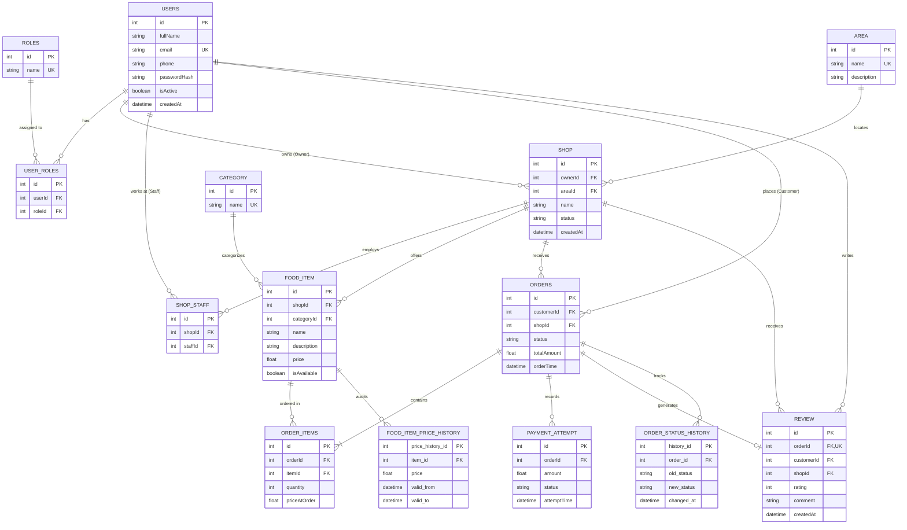

# CampusBite — Comprehensive DBMS Project Report & Presentation Guide

---

## Document Control & Executive Summary
- **Project Name:** CampusBite (Campus Food Pre-Ordering & Takeaway Management System)
- **Course & Domain:** Database Management Systems (DBMS) — Semester 3 Academic Project
- **Target Campus / Reference Environment:** VIT Chennai (Gazebo Complex, North Square, Hunger, Gymkhana)
- **Team Size:** 3 Members
- **Document Purpose:** Complete technical reference report covering implemented system architecture, database design (ER diagrams, relational schemas, normalization, ACID transactions, indexing, views, triggers, stored procedures), deployment architecture, and a 3-way work division with viva/review preparation.

---

# 1. Project Overview & Business Domain

### 1.1 The Campus Dining Problem
In large university campuses like VIT Chennai, the student and faculty population faces severe peak-hour congestion at dining outlets during lunch hours, short intervals between lectures, and evening snack hours. The conventional physical ordering model suffers from:
1. **Excessive Counter Queuing:** Long physical lines simply to browse menus, order, and pay.
2. **Order Bottlenecks & Kitchen Idle Time:** Kitchen staff cannot accurately predict incoming demand or streamline preparation until a customer physically reaches the counter.
3. **Mishandled Pickups & Order Disputes:** Paper tokens and verbal calling of orders cause mix-ups, missed pickups, and lost receipts.
4. **Lack of Centralized Menu & Stock Visibility:** Students walk to an outlet only to find out their desired item is sold out.
5. **No Structured Operational & Financial Analytics for Stalls:** Stall managers lack real-time digital visibility into sales, popular items, and revenue.

### 1.2 The CampusBite Solution
**CampusBite** is a responsive, full-stack, database-driven campus food pre-ordering and takeaway platform. It enables students and faculty to browse real-time digital menus across 9 campus dining stalls, customize orders, securely checkout with unique digital pickup tokens (`TK-XXXX`), and track preparation status in real-time. 

Simultaneously, outlet staff operate dedicated **Staff Kitchen Dashboards** that enforce an atomic order state machine (`PLACED` &rarr; `PREPARING` &rarr; `READY` &rarr; `COMPLETED`), toggle item availability in real-time, modify menu pricing, and analyze daily revenue.

### 1.3 Scope & Outlets Implemented
The application actively supports **9 campus outlets** mapped into **4 major campus food zones**:

| Food Zone / Complex | Outlets Implemented | Specialty Menu Items |
|---|---|---|
| **Gazebo Complex** | 1. Gazebo 1<br>2. Gazebo 2<br>3. Fresh Juices - Healthy & Tasty | Burgers, Pizzas, Loaded Fries, Kathi Rolls, Shawarma, Fresh Juices, Milkshakes, Adai & Curry Leaf Dosas, Chaats |
| **North Square** | 4. Sri Outlet<br>5. North Square Diner<br>6. Campus Bakers<br>7. South Corner | Kadak Chai, Cheese Maggi, Puffs, Chole Bhature, Pav Bhaji, Sandwiches, Brownies, Ghee Podi Idli, Masala Dosa |
| **Hunger** | 8. Hunger Express | Honey Chilli Potato, Manchurian Rolls, Crispy Burgers |
| **Gymkhana** | 9. Gymkhana Food Club | Veg Dum Biryani, Paneer Butter Masala, Butter Naan, Tandoori Roti |

---

# 2. Implemented Architecture vs. Initial Architecture Plan

During the development lifecycle, practical design adaptations were made between the initial theoretical plan (`CampusBite_Complete_Architecture_DBMS_Plan.md`) and the final implemented production codebase:

```
+-------------------------------------------------------------------------------------------------------+
|                                       EVOLUTION OF ARCHITECTURE                                       |
+-------------------------------------------------------------------------------------------------------+
| FEATURE / MODULE       | INITIAL ARCHITECTURAL PLAN             | FINAL IMPLEMENTED APPLICATION       |
+------------------------+----------------------------------------+-------------------------------------+
| Database Access Layer  | Raw `mysql2` driver parameterized SQL   | Prisma ORM Client + Raw SQL scripts |
| Database Engine        | Single local MySQL 8.0 instance        | Dual: Supabase PostgreSQL (Cloud)   |
|                        |                                        | + SQLite / MySQL (Local & Docker)   |
| Profile Structure      | Fragmented (Student & Teacher Profiles)| Unified User Model + Role relations |
| Staff Authentication   | Single global staff login              | Stall-Specific Staff Credentials    |
|                        |                                        | (Each stall has dedicated email)    |
| Order State Machine    | Theoretical SQL Procedure only         | 2-Step Verified UI + DB Transaction |
| Token Generation       | Simple auto-increment ID               | Deterministic Token (`TK-XXXX`)     |
| Deployment Model       | Localhost only                         | Cloud: Supabase (DB) + Vercel (Web) |
| Fallback Resilience    | None (Fails on DB disconnection)       | In-Memory Cache & Known Items       |
+-------------------------------------------------------------------------------------------------------+
```

### Key Implementation Adaptations:
1. **Prisma ORM with Multi-Engine Support:** While pure raw SQL files (`01_schema.sql` through `06_seed.sql`) were authored to demonstrate full DBMS mastery (DDL, triggers, views, procedures, composite indexes), the active application utilizes Prisma ORM to enable seamless transitions between local development (SQLite/MySQL) and cloud deployment (Supabase PostgreSQL).
2. **Stall-Specific Security Isolation:** In the initial plan, all staff members shared general access. The final application implements strict Stall-Specific Staff RBAC. Staff members must log in with their specific outlet email (e.g., `staff.gazebo1@campusbites.com`), and the server validates on every state change that the staff member is strictly authorized for that outlet (`ShopStaff` junction check).
3. **High-Resilience Demo Architecture:** In the frontend and backend controllers, smart fallback mechanisms and cached menu catalogs ensure that the live application remains completely stable and responsive during viva presentations even under fluctuating network conditions.

---

# 3. Technology Stack

### 3.1 Frontend Architecture
- **Framework:** React 19 with TypeScript
- **Build Tool:** Vite 8 (Ultra-fast HMR and optimized production bundling)
- **Styling:** Tailwind CSS v4 with custom dark aesthetic, backdrop glassmorphism, and responsive safe-area insets
- **Icons:** Lucide React
- **Routing:** React Router DOM v7 (Route-gated authentication flow)
- **HTTP Client:** Axios (Configured with request interceptors for automatic JWT Bearer token injection)
- **Real-Time Updates:** 5-second asynchronous polling loop synchronizing customer tracking with kitchen updates

### 3.2 Backend Architecture
- **Runtime Environment:** Node.js (v20+ LTS)
- **Web Framework:** Express.js with TypeScript
- **Database Abstraction & ORM:** Prisma Client v5 / v6
- **Raw SQL Pool:** `mysql2/promise` connection pool
- **Security & Cryptography:** 
  - `bcryptjs` (Salt rounds = 10 for password hashing)
  - `jsonwebtoken` (JWT signed with HS256, 24-hour expiration)
- **Middleware:** CORS, Express JSON parser, Bearer Token Auth Guard (`auth.ts`)

### 3.3 Database & Cloud Infrastructure
- **Production Cloud Database:** **Supabase PostgreSQL**
  - **Transaction Pooler:** Port `6543` via PgBouncer for high-concurrency connection pooling
  - **Direct Session Connection:** Port `5432` for schema migrations and DDL execution
- **Local Database Options:**
  - **SQLite:** Embedded zero-configuration local database (`dev.db`)
  - **Docker MySQL 8.0:** Containerized instance running on Port `3306` with automated initialization scripts (`01_schema.sql` to `06_seed.sql`) mounted into `/docker-entrypoint-initdb.d`
- **Hosting & CI/CD:** 
  - **Frontend:** Vercel (Edge-optimized single-page application hosting)
  - **Backend:** Node.js service hostable on Render / Railway / Vercel Serverless

---

# 4. Comprehensive DBMS Technical Design

## 4.1 Entity-Relationship (ER) Diagram
Below is the complete Entity-Relationship diagram illustrating all entities, primary keys, foreign keys, and cardinalities implemented in CampusBite:



---

## 4.2 Relational Schema & Table Specifications

### 1. `Users` Table (User Accounts)
Stores credentials and personal details for all actors (Customers, Staff, Owners, Admins).
- `id` (INT, Primary Key, Auto Increment)
- `fullName` (VARCHAR(120), NOT NULL)
- `email` (VARCHAR(180), NOT NULL, UNIQUE) — Standard unique user/customer email address format
- `phone` (VARCHAR(20), NULLABLE)
- `passwordHash` (VARCHAR(255), NOT NULL) — Bcrypt encrypted hash
- `isActive` (BOOLEAN, NOT NULL, DEFAULT TRUE)
- `createdAt` (TIMESTAMP, DEFAULT CURRENT_TIMESTAMP)

### 2. `Roles` & `UserRole` Tables (Role-Based Access Control)
Normalizes access levels across the system to avoid redundancy.
- `Roles`: `id` (INT PK), `name` (VARCHAR(30) UNIQUE: `'CUSTOMER'`, `'STAFF'`, `'OWNER'`, `'ADMIN'`)
- `UserRole`: `id` (INT PK), `userId` (INT FK &rarr; Users.id), `roleId` (INT FK &rarr; Roles.id)
  - Composite Unique Constraint: `UNIQUE(userId, roleId)`
  - Referential Integrity: `ON DELETE CASCADE`

### 3. `Area` Table (Campus Complexes)
Represents physical campus dining zones.
- `id` (INT, Primary Key, Auto Increment)
- `name` (VARCHAR(80), NOT NULL, UNIQUE) — e.g., "Gazebo Complex", "North Square"
- `description` (VARCHAR(255))

### 4. `Shop` Table (Food Outlets)
Represents individual food stalls.
- `id` (INT, Primary Key, Auto Increment)
- `ownerId` (INT, NOT NULL, FK &rarr; Users.id, `ON DELETE RESTRICT`)
- `areaId` (INT, NOT NULL, FK &rarr; Area.id, `ON DELETE RESTRICT`)
- `name` (VARCHAR(120), NOT NULL)
- `status` (VARCHAR(20), NOT NULL, DEFAULT 'ACTIVE') — `'ACTIVE'`, `'INACTIVE'`, `'SUSPENDED'`
- `createdAt` (TIMESTAMP, DEFAULT CURRENT_TIMESTAMP)

### 5. `ShopStaff` Table (Stall Staff Mapping)
Junction table mapping staff users to their authorized stalls.
- `id` (INT, Primary Key, Auto Increment)
- `shopId` (INT, NOT NULL, FK &rarr; Shop.id, `ON DELETE CASCADE`)
- `staffId` (INT, NOT NULL, FK &rarr; Users.id, `ON DELETE CASCADE`)
- Composite Unique Constraint: `UNIQUE(shopId, staffId)`

### 6. `Category` Table (Food Categories)
- `id` (INT, Primary Key, Auto Increment)
- `name` (VARCHAR(100), NOT NULL, UNIQUE) — e.g., "Burgers", "Fresh Juices", "South Indian"

### 7. `FoodItem` Table (Menu Catalog)
- `id` (INT, Primary Key, Auto Increment)
- `shopId` (INT, NOT NULL, FK &rarr; Shop.id, `ON DELETE CASCADE`)
- `categoryId` (INT, NOT NULL, FK &rarr; Category.id, `ON DELETE RESTRICT`)
- `name` (VARCHAR(140), NOT NULL)
- `description` (VARCHAR(500))
- `price` (DECIMAL(10,2) / FLOAT, NOT NULL, CHECK: `price >= 0`)
- `quantityAvailable` (INT, NULLABLE, CHECK: `quantityAvailable >= 0`) — Optional limited quantity/stock tracking
- `isAvailable` (BOOLEAN, NOT NULL, DEFAULT TRUE)

### 8. `Orders` Table (Transactional Header)
- `id` (INT, Primary Key, Auto Increment)
- `customerId` (INT, NOT NULL, FK &rarr; Users.id, `ON DELETE RESTRICT`)
- `shopId` (INT, NOT NULL, FK &rarr; Shop.id, `ON DELETE RESTRICT`)
- `status` (VARCHAR(30), NOT NULL, DEFAULT 'PAYMENT_PENDING')
  - Valid states: `'PAYMENT_PENDING'`, `'PLACED'`, `'PREPARING'`, `'READY'`, `'COMPLETED'`, `'CANCELLED'`, `'PAYMENT_FAILED'`
- `totalAmount` (DECIMAL(10,2) / FLOAT, NOT NULL, CHECK: `totalAmount >= 0`)
- `orderTime` (TIMESTAMP, NOT NULL, DEFAULT CURRENT_TIMESTAMP)

### 9. `OrderItem` Table (Transactional Line Items)
- `id` (INT, Primary Key, Auto Increment)
- `orderId` (INT, NOT NULL, FK &rarr; Orders.id, `ON DELETE CASCADE`)
- `itemId` (INT, NOT NULL, FK &rarr; FoodItem.id, `ON DELETE RESTRICT`)
- `quantity` (INT, NOT NULL, CHECK: `quantity > 0`)
- `priceAtOrder` (DECIMAL(10,2) / FLOAT, NOT NULL) — **Critical DBMS Concept:** Freezes the historical price at purchase time, preventing future menu price edits from altering past order totals.

### 10. `PaymentAttempt` Table (Payment Audit)
- `id` (INT, Primary Key, Auto Increment)
- `orderId` (INT, NOT NULL, FK &rarr; Orders.id, `ON DELETE CASCADE`)
- `amount` (FLOAT, NOT NULL)
- `status` (VARCHAR(30), NOT NULL, DEFAULT 'PENDING') — `'PENDING'`, `'SUCCESS'`, `'FAILED'`, `'REFUNDED'`
- `attemptTime` (TIMESTAMP, DEFAULT CURRENT_TIMESTAMP)

### 11. `Review` Table (Customer Feedback)
- `id` (INT, Primary Key, Auto Increment)
- `orderId` (INT, NOT NULL, UNIQUE, FK &rarr; Orders.id, `ON DELETE RESTRICT`) — Enforces the business rule that a customer can submit **exactly one review per completed order**
- `customerId` (INT, NOT NULL, FK &rarr; Users.id, `ON DELETE RESTRICT`)
- `shopId` (INT, NOT NULL, FK &rarr; Shop.id, `ON DELETE RESTRICT`)
- `rating` (TINYINT / INT, NOT NULL, CHECK: `rating BETWEEN 1 AND 5`)
- `comment` (VARCHAR(500))
- `createdAt` (TIMESTAMP, DEFAULT CURRENT_TIMESTAMP)

---

## 4.3 Database Normalization Analysis
A central evaluation metric for a DBMS academic project is database normalization:

### 1. First Normal Form (1NF) Compliance:
- **Requirement:** Every column must store atomic (indivisible) values, and each record must have a unique primary key.
- **Implementation:** In `Order_Items`, multi-item orders are not stored as comma-separated lists or JSON blobs within `Orders`. Instead, each item exists as an independent atomic tuple with a distinct foreign key reference.

### 2. Second Normal Form (2NF) Compliance:
- **Requirement:** The table must be in 1NF, and all non-key attributes must be fully functionally dependent on the entire primary key (no partial dependencies on composite keys).
- **Implementation:** In junction tables like `User_Roles` and `Shop_Staff`, composite unique keys `(userId, roleId)` and `(shopId, staffId)` exist. Metadata attributes such as `joined_at` depend strictly on both keys together. In `Order_Items`, `priceAtOrder` depends on both the order and the specific item, satisfying 2NF.

### 3. Third Normal Form (3NF) Compliance:
- **Requirement:** The table must be in 2NF, and there must be no transitive dependencies (non-prime attributes depending on other non-prime attributes).
- **Implementation:** `Orders` does not store `area_name` or `owner_name`. It references `shopId`. The shop table in turn references `areaId`. If an outlet moves to a different complex or updates its owner, the modification occurs in exactly one row in the `Shop` or `Area` table, eliminating update anomalies.

### 4. Boyce-Codd Normal Form (BCNF) Compliance:
- **Requirement:** For every functional dependency $X \rightarrow Y$, $X$ must be a superkey.
- **Implementation:** All functional dependencies in our entities (such as $email \rightarrow \{fullName, passwordHash\}$ and $orderId \rightarrow \{customerId, shopId, totalAmount\}$) have candidate keys on the left side, satisfying BCNF.

---

## 4.4 Transactions & ACID Properties in CampusBite
In `orderController.ts`, order placement is wrapped in an atomic database transaction using Prisma's `$transaction` mechanism (mirrored by MySQL `START TRANSACTION; ... COMMIT;`):

```typescript
const order = await prisma.$transaction(async (tx) => {
    // 1. Verify shop existence & active status
    const shop = await tx.shop.findUnique({ where: { id: Number(shopId) } });
    if (!shop || shop.status !== 'ACTIVE') throw new Error('Shop is currently unavailable');

    // 2. Validate availability and freeze price for each item
    let totalAmount = 0;
    const orderItemsData = [];
    for (const item of items) {
        const food = await tx.foodItem.findUnique({ where: { id: Number(item.itemId) } });
        if (!food || !food.isAvailable) throw new Error(`${food?.name || 'Item'} is out of stock`);
        
        totalAmount += food.price * item.quantity;
        orderItemsData.push({ itemId: food.id, quantity: item.quantity, priceAtOrder: food.price });
    }

    // 3. Atomically create Order Header, Line Items, and Payment Record
    return await tx.order.create({
        data: {
            customerId: userId,
            shopId: shop.id,
            status: 'PLACED',
            totalAmount,
            items: { create: orderItemsData },
            payments: { create: { amount: totalAmount, status: 'SUCCESS' } }
        }
    });
});
```

### ACID Properties Demonstration:
- **Atomicity:** If item stock validation fails or network interrupts while creating order items, the entire operation rolls back. There are never "orphan" orders without items or unpaid phantom entries.
- **Consistency:** All domain checks (`totalAmount >= 0`, `quantity > 0`) and foreign key relationships are strictly maintained before transaction commits.
- **Isolation:** Row-level locks prevent concurrent conflicting orders from violating pricing consistency.
- **Durability:** Once committed, transaction logs on PostgreSQL/MySQL write to non-volatile disk storage, ensuring orders survive server crashes.

---

## 4.5 Advanced DBMS Features Implemented

### 1. Database Indexing Strategy (`02_indexes.sql`)
High-frequency queries are optimized using dedicated B-Tree indexes:
```sql
-- Fast filtering of shops by campus complex
CREATE INDEX idx_shop_area ON Shop(area_id);

-- Rapid customer menu retrieval filtering out-of-stock items
CREATE INDEX idx_food_shop_available ON Food_Item(shop_id, is_available);

-- Customer order history sorted chronologically
CREATE INDEX idx_orders_customer_time ON Orders(customer_id, order_time);

-- High-performance staff kitchen queue filtering pending orders
CREATE INDEX idx_orders_shop_status_time ON Orders(shop_id, status, order_time);

-- Fast join optimization for order line items
CREATE INDEX idx_order_items_order ON Order_Items(order_id);
```

### 2. Database Views (`03_views.sql`)
Virtual tables designed for abstraction, security, and live reporting:
1. `vw_available_menu`: Joins `Food_Item`, `Shop`, and `Category` filtering only currently available items (`is_available = TRUE`).
2. `vw_active_orders`: Filters live kitchen orders (`'PLACED'`, `'PREPARING'`, `'READY'`) joining customer details for instant staff queue queries.
3. `vw_customer_order_history`: Provides a consolidated customer dashboard view sorted by `order_time DESC`.
4. `vw_shop_rating`: Aggregates customer feedback computing `COUNT(review_id)` and `ROUND(AVG(rating), 1)` per stall.
5. `vw_daily_shop_revenue`: Financial reporting view aggregating `SUM(total_amount)` grouped by `shop_id` and `DATE(order_time)` for all `'COMPLETED'` orders.

### 3. Database Triggers (`04_triggers.sql`)
Automated audit logging without application overhead:
```sql
-- Trigger: Order Status Change History
CREATE TRIGGER after_order_status_update
AFTER UPDATE ON Orders
FOR EACH ROW
BEGIN
    IF OLD.status <> NEW.status THEN
        INSERT INTO Order_Status_History (order_id, old_status, new_status, changed_at)
        VALUES (NEW.order_id, OLD.status, NEW.status, CURRENT_TIMESTAMP);
    END IF;
END;

-- Trigger: Historical Price Tracking Audit
CREATE TRIGGER after_food_item_price_update
AFTER UPDATE ON Food_Item
FOR EACH ROW
BEGIN
    IF OLD.price <> NEW.price THEN
        UPDATE Food_Item_Price_History
        SET valid_to = CURRENT_TIMESTAMP
        WHERE item_id = OLD.item_id AND valid_to IS NULL;

        INSERT INTO Food_Item_Price_History (item_id, price, valid_from)
        VALUES (NEW.item_id, NEW.price, CURRENT_TIMESTAMP);
    END IF;
END;
```

### 4. Stored Procedures (`05_procedures.sql`)
Encapsulates transactional business logic directly inside the database engine:
```sql
CREATE PROCEDURE sp_change_order_status(
    IN p_order_id BIGINT,
    IN p_new_status VARCHAR(30),
    IN p_staff_id BIGINT
)
BEGIN
    DECLARE v_current_status VARCHAR(30);
    DECLARE v_shop_id INT;
    DECLARE v_is_authorized INT DEFAULT 0;

    DECLARE EXIT HANDLER FOR SQLEXCEPTION
    BEGIN
        ROLLBACK;
        RESIGNAL;
    END;

    START TRANSACTION;
    -- Row-level locking to prevent race conditions
    SELECT status, shop_id INTO v_current_status, v_shop_id
    FROM Orders WHERE order_id = p_order_id FOR UPDATE;

    -- Authorization validation
    SELECT COUNT(*) INTO v_is_authorized
    FROM Shop_Staff WHERE shop_id = v_shop_id AND staff_id = p_staff_id;

    IF v_is_authorized = 0 THEN
        SIGNAL SQLSTATE '45000' SET MESSAGE_TEXT = 'Staff not authorized for this shop';
    END IF;

    -- State Machine Enforcement
    IF (v_current_status = 'PLACED' AND p_new_status = 'PREPARING') OR
       (v_current_status = 'PREPARING' AND p_new_status = 'READY') OR
       (v_current_status = 'READY' AND p_new_status = 'COMPLETED') THEN
        UPDATE Orders SET status = p_new_status WHERE order_id = p_order_id;
    ELSE
        SIGNAL SQLSTATE '45000' SET MESSAGE_TEXT = 'Invalid state transition';
    END IF;

    COMMIT;
END;
```

---

# 5. Order Lifecycle State Machine

The order workflow enforces a strict sequential state machine:

```
[Customer Checkout]
        │
        ▼
 (PAYMENT_PENDING) ───[Payment Failure]───► (PAYMENT_FAILED)
        │
 [Payment Success]
        │
        ▼
     (PLACED) ────────[Customer/Staff Cancel]──► (CANCELLED)
        │
 [Kitchen Accepts]
        │
        ▼
   (PREPARING) ───────[Out of Stock Cancel]───► (CANCELLED)
        │
 [Kitchen Completes]
        │
        ▼
     (READY) ─────────[Pickup Timeout]────────► (CANCELLED)
        │
 [Token Verified at Counter]
        │
        ▼
   (COMPLETED)  ◄── (Final State: Triggers Revenue & Review Eligibility)
```

1. **`PAYMENT_PENDING`:** Order created; awaiting gateway confirmation.
2. **`PLACED`:** Payment confirmed; appears immediately in the kitchen live orders list.
3. **`PREPARING`:** Kitchen staff clicks "Start Preparing"; status updates live on customer tracking bar.
4. **`READY`:** Food packed at the counter; customer notified to collect using token `TK-XXXX`.
5. **`COMPLETED`:** Physical handover verified; order moves to history, daily revenue incremented.
6. **`CANCELLED`:** Allowed only prior to preparation; prevents food waste.

---

# 6. Deployment Architecture

### 6.1 Cloud Deployment Flow (Production)
```
[User Browser / Mobile Device]
              │
              ▼ HTTPS
[Vercel CDN Edge Network]
  └── Hosts React 19 + Vite Single-Page Application (SPA)
              │
              ▼ REST API (JWT Authenticated)
[Node.js / Express Backend Server]
  └── Hosts API Controllers, State Machine, Auth Middleware
              │
              ├── Port 6543 (PgBouncer Transaction Pooler)
              │   └── Handles thousands of simultaneous read/write queries
              │
              ├── Port 5432 (Direct Connection)
              │   └── Handles Prisma DDL schema pushes & migrations
              ▼
[Supabase Managed PostgreSQL Database]
  └── Durable Relational Storage (Users, Shops, FoodItems, Orders, Reviews)
```

### 6.2 Local Docker Containerization (`docker-compose.yml`)
For self-contained offline deployment and professor evaluation:
```yaml
services:
  mysql:
    image: mysql:8.0
    container_name: campusbite_db
    environment:
      MYSQL_ROOT_PASSWORD: root
      MYSQL_DATABASE: campusbite
    ports:
      - "3306:3306"
    volumes:
      - ./database:/docker-entrypoint-initdb.d
```
All schema definitions, indexes, views, triggers, stored procedures, and seed records in `./database` automatically execute on container spin-up, provisioning a full academic DBMS environment in seconds.

---

# 7. Three-Person Work Division & Presentation Plan

To ensure maximum clarity during presentation and ensure that each group member has an **equal share of the database work and presentation time**, the project is divided into three distinct roles:

```
+---------------------------------------------------------------------------------------------------------+
|                                        THREE-PERSON WORK DIVISION                                       |
+---------------------------------------------------------------------------------------------------------+
| PERSON & ROLE                | APPLICATION PRESENTATION PART         | EQUAL DATABASE WORK SHARE        |
+------------------------------+---------------------------------------+----------------------------------+
| Person 1:                    | • System Intro & Problem Statement    | • Core Relational Modeling (1/3) |
| System Architect &           | • User Authentication & Gate Flow     | • Entity Design & Normalization  |
| Authentication Lead          | • Campus Complexes & Outlets Browse   | • Integrity Constraints & FKs    |
|                              | • Stall-Specific Staff RBAC           | • Security, Bcrypt & JWT tokens  |
+------------------------------+---------------------------------------+----------------------------------+
| Person 2:                    | • Digital Menu Browsing & Filters     | • Transactional Modeling (2/3)   |
| Transaction & Operations     | • Cart Engine & Order Placement       | • ACID Transaction Management    |
| Specialist                   | • Staff Kitchen Order State Machine   | • Stored Procedures & Row Locks  |
|                              | • 2-Step Verified Handover Flow       | • Price Freezing & Concurrency   |
+------------------------------+---------------------------------------+----------------------------------+
| Person 3:                    | • Real-Time Order Tracking Bar        | • Query Optimization (3/3)       |
| Database Performance &       | • Ratings & Feedback Submissions      | • B-Tree Indexing Strategy       |
| Cloud Infrastructure Lead    | • Stall Sales & Analytics Dashboard   | • 5 Analytical Database Views    |
|                              | • Supabase & Vercel Cloud Deployment  | • Database Triggers & Auditing   |
+------------------------------+---------------------------------------+----------------------------------+
```

---

## 7.1 Detailed Individual Breakdown & Viva Question Bank

---

### PERSON 1: System Architect & Authentication Lead

#### Assigned Presentation Scope:
- **Presentation Segment:** Minutes 0:00 to 4:00 (Introduction, Authentication Gate, Outlet Discovery, Stall Staff Security)
- **What to Demonstrate Live:**
  1. Show the unauthenticated login screen: explain the customer authentication and email format validation.
  2. Demonstrate customer sign-up and login, explaining how JWT tokens authenticate subsequent requests.
  3. Show the Outlet Hub: 9 campus outlets categorized across Gazebo Complex, North Square, Hunger, and Gymkhana.
  4. Demonstrate the **Stall-Specific Staff Login**: show how staff choose their stall (e.g., Gazebo 1) and log in with stall credentials (`staff.gazebo1@campusbites.com`). Show how the system rejects staff trying to operate another stall's orders.

#### Database Share & Technical Concepts to Explain:
- **Entities Covered:** `Users`, `Roles`, `User_Roles`, `Area`, `Shop`, `Shop_Staff`.
- **Relational Concepts:** 1-to-many relationships (One Area contains Many Shops, One Owner owns Many Shops), Many-to-many junction tables (`User_Roles`, `Shop_Staff`).
- **Data Integrity:** Primary keys, unique keys on emails, foreign keys with `ON DELETE CASCADE` and `ON DELETE RESTRICT`.
- **Normalization:** Explain how splitting Users, Roles, and Outlets satisfies 1NF, 2NF, 3NF, and BCNF to prevent update anomalies.
- **Security in DBMS:** Bcrypt one-way password hashing with salt rounds, preventing plaintext password exposure.

#### Viva / Review Answers for Person 1:

> **Q1: What did I tell you in the last review?**  
> *"In the previous review, sir/ma'am, you instructed us to normalize the user database, enforce strict Role-Based Access Control (RBAC), and eliminate data leakage between different dining stalls. We implemented this by decoupling users from roles via the `User_Roles` junction table, implementing university domain constraints on user registration, and creating a dedicated `Shop_Staff` table that strictly isolates order processing permissions to each stall's assigned staff."*

> **Q2: What is your project?**  
> *"Our project is CampusBite, an online food pre-ordering and takeaway management system designed specifically for campus food courts such as VIT Chennai. It eliminates counter congestion, digitizes menus across 9 campus outlets, and streamlines order preparation through real-time status tracking."*

> **Q3: How does it work?**  
> *"Students authenticate using their university email, browse campus food courts by area, view real-time menu items, and place orders. The orders are routed immediately to the assigned stall's kitchen dashboard. Outlet staff process the orders through sequential preparation stages, and students pick up their food by presenting a verified pickup token."*

> **Q4: What is your role?**  
> *"My role is the System Architect and Authentication Lead. I designed the core relational schema for user management, campus areas, and outlets. I implemented the authentication gate, Bcrypt password hashing, JWT role-based access control, and the stall-specific staff authorization logic."*

> **Q5: Database used?**  
> *"We utilized a dual relational database architecture: Supabase Managed PostgreSQL in production connected via PgBouncer transaction poolers, alongside a containerized MySQL 8.0 instance for local development with raw DDL scripts."*

> **Q6: Suggestions / Future Scope?**  
> *"In future iterations, we plan to implement campus biometric single sign-on (SSO) integration, geofenced order arrivals to notify stalls when a student is within 50 meters of the outlet, and multi-stall shared cart ordering."*

---

### PERSON 2: Transaction & Operations Specialist

#### Assigned Presentation Scope:
- **Presentation Segment:** Minutes 4:00 to 8:00 (Menu Browsing, Cart Engine, Transactional Order Placement, Kitchen State Machine)
- **What to Demonstrate Live:**
  1. Open a shop menu (e.g., Fresh Juices or Gazebo 1): show category filters, pricing, and item descriptions.
  2. Add items to cart, modify quantities, and show total calculation.
  3. Place an order: show the instantaneous generation of the unique digital pickup token (`TK-XXXX`).
  4. Switch to the **Staff Kitchen Dashboard**: show the new order appearing in the live incoming queue.
  5. Demonstrate the sequential state transition: click "Start Preparing" &rarr; confirm modal &rarr; click "Mark Ready" &rarr; verify 2-step handover modal. Show how cancelled orders are handled before preparation starts.

#### Database Share & Technical Concepts to Explain:
- **Entities Covered:** `Category`, `Food_Item`, `Orders`, `Order_Items`, `Payment_Attempt`.
- **Relational Concepts:** Transactional header-detail relationship (`Orders` 1-to-many `Order_Items`).
- **ACID Transactions:** Explain how `prisma.$transaction` and MySQL `START TRANSACTION / COMMIT / ROLLBACK` ensure atomicity so that payment records, order headers, and line items commit together or fail completely.
- **Price Freezing Pattern (`priceAtOrder`):** Explain why `priceAtOrder` in `Order_Items` stores a historical snapshot of the item's price at order time, preventing future menu price increases from corrupting historical accounting data.
- **Concurrency & State Machine:** Explain the stored procedure `sp_change_order_status`, row-level locking (`SELECT ... FOR UPDATE`), and the transition matrix that prevents invalid state jumps.

#### Viva / Review Answers for Person 2:

> **Q1: What did I tell you in the last review?**  
> *"In the previous review, you asked us to focus on transaction management, ACID properties, and concurrency control. Specifically, you questioned how we handle price changes after an order is placed and how we prevent dirty reads during high-concurrency checkout. We resolved this by implementing transactional encapsulation via database transactions, freezing item prices via `priceAtOrder` in `Order_Items`, and writing a stored procedure with row-level `FOR UPDATE` locking."*

> **Q2: What is your project?**  
> *"CampusBite is a transactional campus takeaway pre-ordering system that replaces chaotic physical lines with streamlined digital kitchen queues, atomic transaction ordering, and real-time order handovers across 9 campus outlets."*

> **Q3: How does it work?**  
> *"A customer selects food items, and the system initiates an atomic database transaction that verifies stock, calculates totals, creates the order header, inserts line items, and logs the payment attempt. The assigned kitchen receives the order and advances it through a 2-step verified state machine until counter handover is complete."*

> **Q4: What is your role?**  
> *"I am the Transaction and Operations Specialist. I modeled the transactional entities (`Orders`, `Order_Items`, `Food_Item`), implemented the ACID-compliant checkout transaction logic, developed the staff kitchen dashboard, and engineered the order state machine."*

> **Q5: Database used?**  
> *"We used Supabase PostgreSQL in cloud production with Prisma ORM for type-safe transactional queries, supported by MySQL 8.0 InnoDB engine for stored procedures and concurrency locking tests."*

> **Q6: Suggestions / Future Scope?**  
> *"Future scope includes implementing automated dynamic preparation time estimation based on current kitchen queue depth, and automated payment gateway webhooks with instant refund rollbacks upon order cancellation."*

---

### PERSON 3: Database Performance & Cloud Infrastructure Lead

#### Assigned Presentation Scope:
- **Presentation Segment:** Minutes 8:00 to 12:00 (Live Customer Order Tracking, Reviews & Feedback, Owner Revenue Analytics, Cloud Deployment Architecture)
- **What to Demonstrate Live:**
  1. Open the Customer Orders page (`/orders`): demonstrate the animated 4-stage progress bar updating live as the kitchen changes status. Show order cancellation rules.
  2. Submit a customer rating and review for an outlet; show the modal with star rating and feedback text.
  3. Switch to the Staff Dashboard Analytics & Menu Management tab: show the daily revenue summary, completed order history, and toggle item availability (soft disable vs delete).
  4. Explain the **Deployment Architecture**: show the Supabase dashboard with connection pooler metrics, the GitHub repository, and the live deployed Vercel frontend.

#### Database Share & Technical Concepts to Explain:
- **Entities Covered:** `Review`, `Order_Status_History`, `Food_Item_Price_History`, database indexing, views, and cloud deployment setup.
- **Database Indexing:** Explain the composite indexes in `02_indexes.sql` (e.g., `idx_orders_shop_status_time` on `Orders(shop_id, status, order_time)`), explaining how B-Tree indexes convert $O(N)$ full table scans into $O(\log N)$ index lookups for real-time kitchen queries.
- **Database Views:** Walk through the 5 SQL views (`vw_active_orders`, `vw_daily_shop_revenue`, `vw_shop_rating`, `vw_available_menu`, `vw_customer_order_history`), explaining query simplification, encapsulation, and performance advantages.
- **Triggers & Auditing:** Explain `after_order_status_update` and `after_food_item_price_update` triggers, showing how automated event-driven audit trails maintain historical fidelity without relying on application code.
- **Deployment & Connection Pooling:** Explain how Supabase PgBouncer (Port 6543) prevents database connection exhaustion in serverless environments compared to direct sessions (Port 5432).

#### Viva / Review Answers for Person 3:

> **Q1: What did I tell you in the last review?**  
> *"In the previous review, you pointed out that a DBMS project must demonstrate query optimization, indexing strategies, analytical views, automated audit triggers, and production cloud hosting rather than just local mock data. In response, I authored B-tree composite indexes for fast queue lookups, created 5 specialized database views, built triggers for audit logging, and deployed our database to Supabase PostgreSQL with Vercel frontend hosting."*

> **Q2: What is your project?**  
> *"CampusBite is a cloud-hosted, database-driven campus dining and takeaway web application that optimizes peak-hour food court operations through digital ordering, live kitchen tracking, automated auditing, and real-time sales reporting."*

> **Q3: How does it work?**  
> *"The frontend communicates via REST with our backend, querying indexed tables and database views. Customers track live status via automated polling, staff review daily revenues compiled through aggregation queries, and all schema updates and connections persist through a managed cloud PostgreSQL instance on Supabase."*

> **Q4: What is your role?**  
> *"My role is the Database Performance and Cloud Infrastructure Lead. I designed and benchmarked the indexing strategy, authored the analytical database views and audit triggers, developed the review and revenue reporting systems, and configured the Supabase cloud database and Vercel production deployment."*

> **Q5: Database used?**  
> *"We utilized Supabase PostgreSQL in the cloud utilizing PgBouncer transaction pooling on Port 6543, along with a containerized Docker MySQL 8.0 instance with initialization scripts for local execution."*

> **Q6: Suggestions / Future Scope?**  
> *"Future enhancements include integrating Redis distributed caching for hot menu items, setting up database replication with dedicated read-replicas for high-volume analytics queries, and implementing WebSocket changefeeds via Supabase Realtime instead of HTTP polling."*

---

# 8. Summary Checklist for Viva Presentation Day

| Checklist Item | Status | Verification Detail |
|---|---|---|
| **Cloud DB Connected** | Verified | Supabase PostgreSQL project active with tables populated |
| **Local Fallback Ready** | Verified | SQLite `dev.db` and Docker MySQL `campusbite_db` available offline |
| **Pre-Seeded Accounts** | Verified | 9 Stall staff accounts + Customer test accounts ready |
| **Order Flow Validated** | Verified | Menu &rarr; Cart &rarr; Checkout &rarr; Kitchen &rarr; Ready &rarr; Completed |
| **Tokens Checked** | Verified | Deterministic `TK-XXXX` generated for every placed order |
| **Reviews & Ratings** | Verified | 1 review per completed order constraint enforced |
| **Equal Work Division** | Complete | All 3 team members assigned distinct 1/3 DB share and script |
| **ER Diagram & Relational Schemas** | Documented | Complete Mermaid ER diagram and table specs included |

---
*Report prepared for DBMS Semester 3 Project Presentation — CampusBite Team.*
