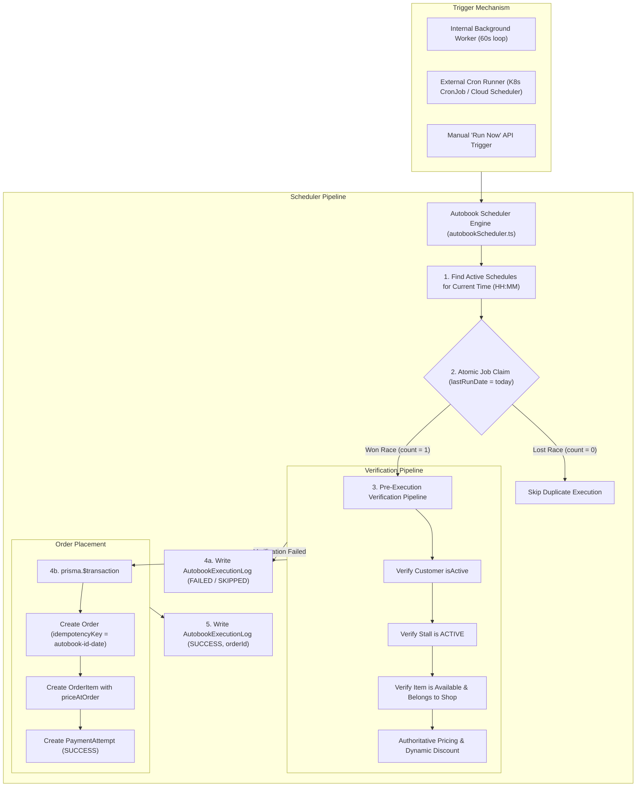

# Campus Bites — Autobook Background Scheduling Engine Architecture

## 1. Executive Summary

Autobook enables university students to schedule recurring daily breakfast, snack, and meal bookings (e.g. "Order Masala Dosa from Stall 1 every morning at 08:30"). 

Early prototype iterations attempted to trigger orders through browser JavaScript `setInterval` timers or client-side triggers. This approach suffered from severe limitations: if a student's phone entered sleep mode, or their browser tab was discarded, scheduled meals failed to trigger.

Campus Bites has replaced all browser-bound scheduling with an **autonomous, backend-driven scheduler worker** (`backend/src/services/autobookScheduler.ts`) featuring:
- **Atomic job claiming** that prevents duplicate orders across horizontal backend worker replicas.
- **Strict pre-execution verification** (ensuring student account status, outlet open status, live stock availability, and dynamic discounts are re-evaluated).
- **Execution audit logging** in `AutobookExecutionLog` with status (`SUCCESS`, `SKIPPED`, `FAILED`).
- **RESTful lifecycle controls** (pause, resume, edit, cancel, manual execution).

---

## 2. Architectural Overview



---

## 3. Atomic Job Claiming Algorithm

In a production campus deployment with multiple backend replicas (e.g., clustered Node.js instances or Kubernetes pods), running scheduler loops simultaneously could cause catastrophic duplicate orders if two pods attempt to fire the same student's 08:30 schedule.

Campus Bites prevents this with a **two-tier concurrency shield**.

### Tier 1: Conditional Row Lock via Atomic Update
Before placing any order, the worker executes an atomic SQL update query:

```typescript
const claim = await prisma.autobookSchedule.updateMany({
    where: {
        id: schedule.id,
        isActive: true,
        OR: [
            { lastRunDate: null },
            { lastRunDate: { not: todayDateStr } }
        ]
    },
    data: {
        lastRunDate: todayDateStr
    }
});

if (claim.count === 0) {
    // Another worker has already claimed or completed this job today.
    return { status: 'SKIPPED', errorMessage: 'Schedule already claimed by another worker' };
}
```

Because PostgreSQL serializes updates on individual rows, only **one** worker will observe `claim.count === 1`. All other workers observe `claim.count === 0` and immediately skip.

### Tier 2: Database Unique Idempotency Key
Even if network partitioning or unexpected transaction isolation behaviors occur, the created `Order` record carries a deterministic idempotency key:
$$\text{idempotencyKey} = \text{"autobook-" + schedule.id + "-" + todayDateStr}$$
The database enforces a `@unique` index on `Order.idempotencyKey`. It is physically impossible for two orders to be inserted for the same schedule on the same calendar day.

---

## 4. Pre-Execution Verification Pipeline

A student may register an Autobook schedule weeks in advance. By the time 08:30 AM arrives, physical kitchen realities may have shifted:
1. **Student Account Active Check**:
   Verifies `user.isActive === true`. Inactive or suspended students cannot place orders.
2. **Stall Status Check**:
   Verifies `shop.status === 'ACTIVE'`. If the outlet is closed for maintenance or festival holidays, the execution gracefully records `status: 'SKIPPED'`, `errorMessage: 'Stall is currently closed'`.
3. **Item Availability & Stall Ownership**:
   Verifies `foodItem.isAvailable === true` and `foodItem.shopId === schedule.shopId`. If the item sold out earlier that morning, the schedule records `status: 'SKIPPED'`, `errorMessage: 'Item is currently sold out'`.
4. **Dynamic Price Recalculation**:
   The engine does not trust saved prices from schedule registration. It recomputes current prices directly from the menu item, applying active dynamic pricing discounts and closing clearance discounts.
5. **Kitchen Queue Estimation**:
   Computes live queue count and wait time so the ticket appears in the kitchen queue with an accurate preparation window.

---

## 5. Execution Audit Log (`AutobookExecutionLog`)

Every schedule execution attempt writes an immutable entry into `AutobookExecutionLog`:

| Column | Type | Description |
|---|---|---|
| `id` | `Int` (PK) | Auto-increment primary key |
| `scheduleId` | `Int` (FK) | Reference to `AutobookSchedule.id` |
| `attemptTime` | `DateTime` | Timestamp of execution attempt |
| `status` | `String` | Outcome: `SUCCESS`, `SKIPPED`, `FAILED` |
| `orderId` | `Int?` (FK) | ID of created `Order` (if successful) |
| `errorMessage` | `String?` | Descriptive reason if skipped or failed |

### Audit Status Definitions:
- **`SUCCESS`**: Verification passed, atomic transaction succeeded, order placed and confirmed.
- **`SKIPPED`**: Routine environmental condition prevented placement (e.g. stall closed, item sold out, already run today).
- **`FAILED`**: Critical error (e.g. user deleted, corrupt foreign key, database timeout).

Students can inspect recent execution history in their Autobook schedule settings drawer to know why a scheduled order ran or skipped.

---

## 6. Schedule Management API Reference

All management endpoints require customer authentication. Customers can only view and modify their own schedules; `ADMIN` users can inspect all.

### 6.1 Create Schedule
- **`POST /api/autobook/schedules`** (and `/api/orders/autobook/schedules`)
- Body:
  ```json
  {
    "shopId": 1,
    "itemId": 101,
    "quantity": 2,
    "scheduledTime": "08:30",
    "isActive": true
  }
  ```
- Validation: Enforces 24-hour `HH:MM` format regex, stall existence, and item existence.

### 6.2 Pause & Resume (Toggle)
- **`PATCH /api/autobook/schedules/:scheduleId/toggle`**
- Body (optional): `{ "isActive": false }`
- Flips active state. Paused schedules are skipped during daily runs without deleting the configuration.

### 6.3 Edit Schedule
- **`PUT /api/autobook/schedules/:scheduleId`** (or `PATCH`)
- Body: `{ "quantity": 3, "scheduledTime": "09:00" }`
- Updates schedule settings with schema validation.

### 6.4 Cancel / Remove Schedule
- **`DELETE /api/autobook/schedules/:scheduleId`**
- Removes the recurring schedule. Historical execution logs and orders are preserved.

### 6.5 Immediate Manual Run
- **`POST /api/autobook/schedules/:scheduleId/run`**
- Allows the student or staff to trigger an immediate test order bypassing the clock.

### 6.6 View Execution Audit Logs
- **`GET /api/autobook/schedules/:scheduleId/logs`**
- Returns recent 50 execution attempts with order links and error messages.

### 6.7 Scheduler Cycle Runner (Cron Trigger)
- **`POST /api/autobook/trigger-cycle`**
- Body (optional): `{ "targetTime": "08:30", "targetDate": "2026-10-24" }`
- Allows external cron managers (or automated integration tests) to trigger an evaluation pass.

---

## 7. Deployment & Operational Runbook

### Continuous Worker Mode
In single-instance or standard VM deployments, `startAutobookScheduler()` is launched during server initialization in `app.ts`. It ticks every 60 seconds.

### Kubernetes / Serverless Cron Mode
In high-scale containerized clusters:
1. Disable internal intervals via environment variable `ENABLE_INTERNAL_SCHEDULER=false`.
2. Configure a Kubernetes `CronJob` or AWS EventBridge / Cloud Scheduler to invoke:
   ```bash
   curl -X POST https://api.campusbites.internal/api/autobook/trigger-cycle \
     -H "Authorization: Bearer $CRON_SERVICE_TOKEN"
   ```
   Every 60 seconds (`* * * * *`).

### Error Recovery & Health Probes
- If a database connectivity blip occurs during a scheduled run, the worker logs the error without crashing.
- On the next 60-second cycle, any un-executed schedule will be picked up and claimed if the time matches.
