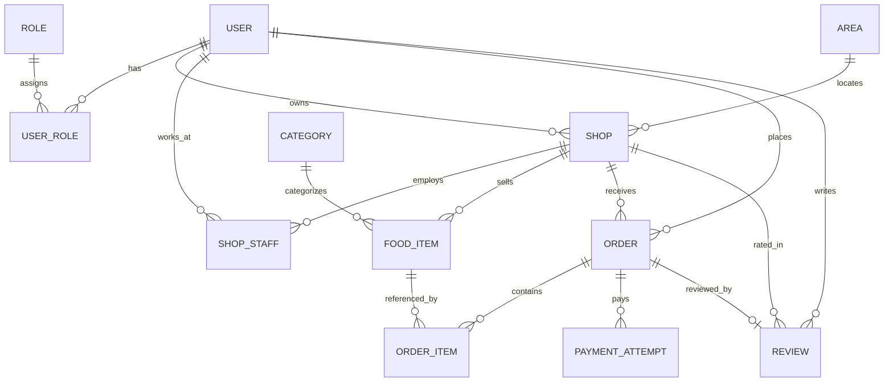
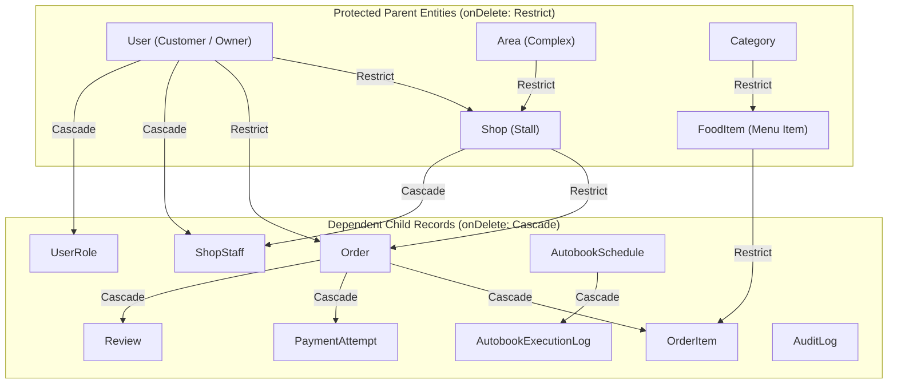
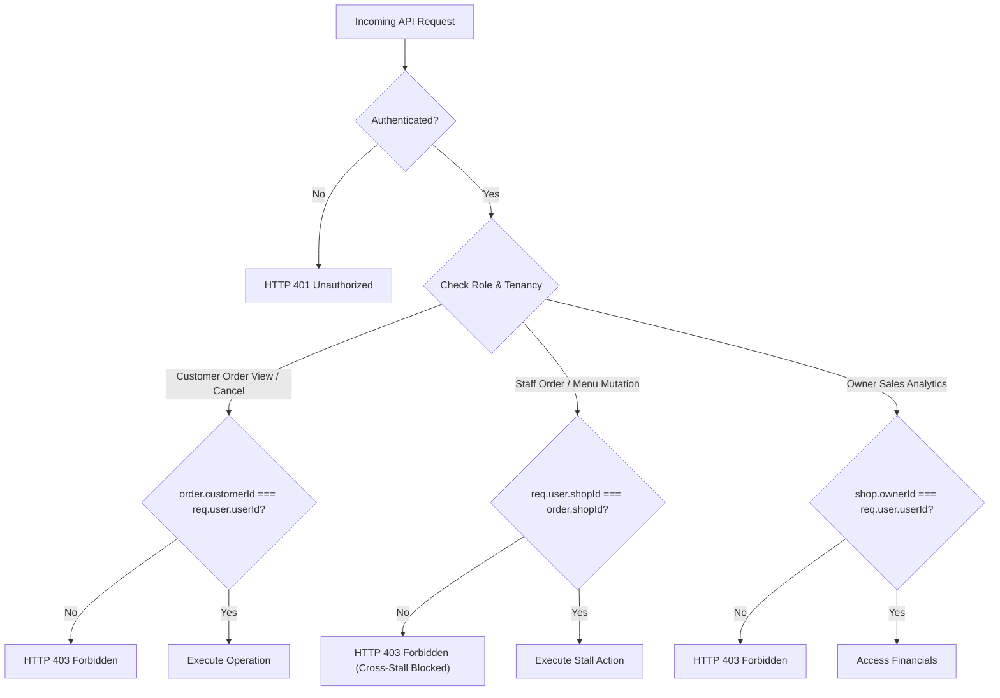
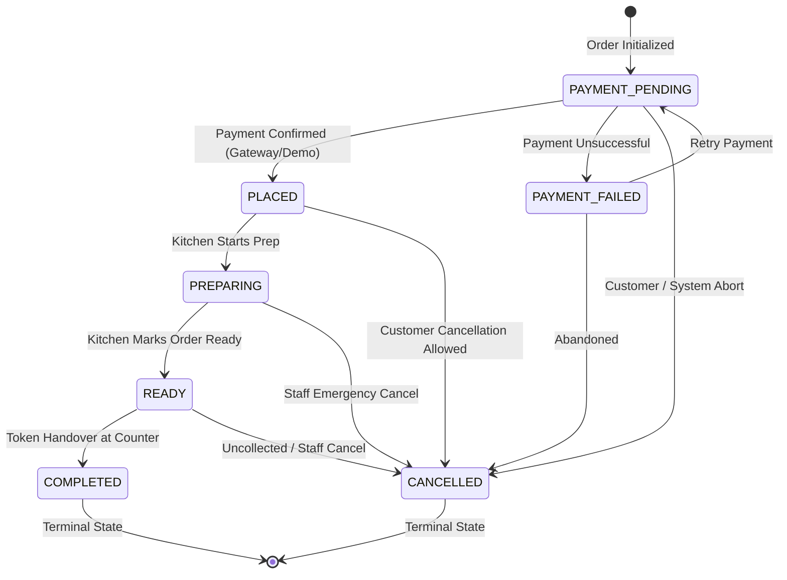

# Campus Bites — Data Integrity & Architectural Specification

**Document Version**: 2.0  
**Domain**: Database Architecture, Constraints, Referential Safety, and State Machine Validation  
**Status**: Verified & Enforced  

---

## 1. Relational Integrity & Prisma Constraints

The Campus Bites relational schema is modeled in PostgreSQL using Prisma ORM. Referential integrity is guaranteed through database-level foreign keys, compound uniqueness indices, and strict deletion rules.



### 1.1 Uniqueness Constraints
1. **`User.email` (`@unique`)**: Guarantees distinct customer, staff, and admin identities. Prevents duplicate credential registration.
2. **`Role.name` (`@unique`)**: Enforces distinct system roles (`CUSTOMER`, `STAFF`, `OWNER`, `ADMIN`).
3. **`Area.name` (`@unique`)**: Enforces distinct physical campus food court complexes (e.g. Gazebo Complex, North Square).
4. **`Category.name` (`@unique`)**: Prevents duplicate food categories.
5. **`UserRole` (`@@unique([userId, roleId])`)**: Prevents duplicate role assignments for the same user.
6. **`ShopStaff` (`@@unique([shopId, staffId])`)**: Prevents duplicate staff bindings to the same outlet.
7. **`Order.idempotencyKey` (`@unique`)**: Prevents double-charging or double-order creation on rapid repeated network submissions.
8. **`Review.orderId` (`@unique`)**: Strictly enforces the business rule that **one order can only be reviewed once**, eliminating fake review spamming.

---

## 2. Cascade Deletion vs Restrict Policies

The deletion semantics across the schema are carefully differentiated into **Parent Protection (`Restrict`)** and **Child Cleanup (`Cascade`)**:



### 2.1 Restricted Deletions (Audit & Ledger Protection)
- **`Order.customer` -> `User` (`onDelete: Restrict`)**: A user cannot be deleted while they have order history. This protects historical financial accounting.
- **`Order.shop` -> `Shop` (`onDelete: Restrict`)**: A stall cannot be deleted while past orders reference it.
- **`OrderItem.item` -> `FoodItem` (`onDelete: Restrict`)**: A food item cannot be dropped from the database if historic customer orders reference it. Stalls must instead mark items unavailable (`isAvailable: false`).
- **`Shop.owner` -> `User` (`onDelete: Restrict`)**: A stall owner account cannot be deleted while active shops are owned.
- **`Shop.area` -> `Area` (`onDelete: Restrict`)**: An area cannot be deleted while stalls reside within it.

### 2.2 Cascaded Deletions (Child Dependency Cleanup)
- **`Order` -> `OrderItem` (`onDelete: Cascade`)**: Deleting an order cleans up line items.
- **`Order` -> `PaymentAttempt` (`onDelete: Cascade`)**: Deleting an order cleans up payment attempts.
- **`Order` -> `Review` (`onDelete: Cascade`)**: Removing an order cleans up its review.
- **`ShopStaff` -> `Shop` & `User` (`onDelete: Cascade`)**: Removing either the staff user or shop cleans up the binding.
- **`AutobookSchedule` -> `AutobookExecutionLog` (`onDelete: Cascade`)**: Removing a schedule cleans up execution logs.

---

## 3. Monetary Precision & Historical Snapshot Pricing

Floating point math in distributed systems is susceptible to binary floating-point rounding errors (e.g. `0.1 + 0.2 === 0.30000000000000004`). Campus Bites enforces strict monetary precision:

### 3.1 Server-Authoritative Price Calculation
1. **Client Prices Are Never Trusted**: Any price sent in the checkout payload is stripped and discarded.
2. **Authoritative DB Lookup**: The server pulls `food.price`, `food.originalPrice`, `food.discountPercent`, `shop.isClosingSoon`, and `shop.closingDiscount` directly from the database within an isolated database transaction (`prisma.$transaction`).
3. **Exact 2-Decimal Precision**:
   ```ts
   let unitPrice = Math.round(food.price * 100) / 100;
   if (food.isDynamicPricing && food.discountPercent && food.discountPercent > 0) {
       const orig = food.originalPrice || food.price;
       unitPrice = Math.max(5, Math.round(orig * (1 - food.discountPercent / 100) * 100) / 100);
   } else if (shop.isClosingSoon && shop.closingDiscount && shop.closingDiscount > 0) {
       unitPrice = Math.max(5, Math.round(food.price * (1 - shop.closingDiscount / 100) * 100) / 100);
   }
   calculatedTotal = Math.round((calculatedTotal + unitPrice * qty) * 100) / 100;
   ```

### 3.2 Historical Snapshot Isolation
- **`OrderItem.priceAtOrder`**: Captures the exact unit price billed at the timestamp of the transaction.
- **Menu Price Mutation Independence**: When a shop owner updates a food item's price (e.g. from ₹85 to ₹120), all past orders remain pinned to their historical `priceAtOrder` (`85.00`), guaranteeing accounting integrity.
- Verified by automated test: `Monetary precision: Order preserves snapshot price even if menu item price changes`.

---

## 4. Multi-Tenant Ownership & Authorization Isolation

All operations on sensitive business entities undergo strict tenancy and ownership verification before database execution:



1. **Customer Order Ownership**:
   - `orderController.ts`: `if (order.customerId !== userId && req.user?.role !== 'ADMIN') throw HTTP 403`.
   - Customer B cannot view, cancel, or modify Customer A's orders.
2. **Review Verified Purchase Requirement**:
   - `reviewController.ts`: Reviews can only be submitted for completed orders (`verifiedOrder.status === 'COMPLETED'`) belonging to the authenticated customer (`verifiedOrder.customerId === customerId`) and matching the shop (`verifiedOrder.shopId === shopId`).
3. **Staff Stall Scoping**:
   - Staff members are bound to their assigned stall. Staff at Stall 1 cannot modify menu items, update inventory, or transition orders belonging to Stall 2.
4. **Owner Stall Scoping**:
   - Outlet owners can only view sales, revenue, and queue statistics for stalls where `shop.ownerId === req.user.userId`.

---

## 5. Order Lifecycle State Machine Validation

Order status progression follows an explicit directed state machine. Illegal status transitions are rejected at both controller and database levels:



### 5.1 Permitted Transitions Table
| Current Status | Allowed Next States | Permitted Actors | Customer Self-Cancel? |
| :--- | :--- | :--- | :--- |
| **`PAYMENT_PENDING`** | `PLACED`, `PREPARING`, `PAYMENT_FAILED`, `CANCELLED` | Customer, System | **YES** |
| **`PLACED`** | `PREPARING`, `READY`, `CANCELLED` | Staff, Customer, Admin | **YES** |
| **`PREPARING`** | `READY`, `COMPLETED`, `CANCELLED` | Staff, Admin | **NO (Locked in Kitchen)** |
| **`READY`** | `COMPLETED`, `CANCELLED` | Staff, Admin | **NO (Awaiting Pickup)** |
| **`COMPLETED`** | *None (Terminal)* | Terminal | **NO** |
| **`CANCELLED`** | *None (Terminal)* | Terminal | **NO** |
| **`PAYMENT_FAILED`** | `PAYMENT_PENDING`, `CANCELLED` | Customer, System | **YES** |

### 5.2 Transition Rules
- **Customer Cancellation Restriction**: Customers can only cancel orders in `PAYMENT_PENDING` or `PLACED` status. Once kitchen preparation begins (`PREPARING`), cancellations are locked.
- **Double Submission Guard**: Identical orders submitted within 4 seconds with identical items and totals are de-duplicated by the order transaction.
- **Idempotency Key**: Guarantees exactly-once processing for payment confirmations and order creation.
