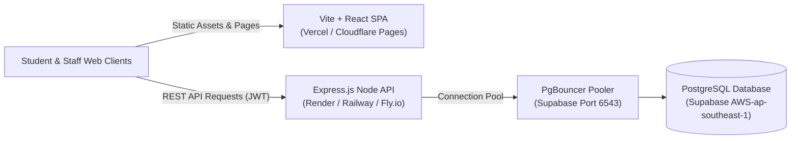

# Campus Bites - Production Deployment Guide

This guide details the step-by-step procedures, cloud hosting options, CI/CD automated deployment pipelines, database migration safeguards, and rollback strategies for the Campus Bites application.

---

## 1. Architecture Overview

Campus Bites consists of two decoupled services interacting with cloud database infrastructure:



---

## 2. Recommended Hosting Targets

| Component | Recommended Host | Rationale | Alternatives |
| :--- | :--- | :--- | :--- |
| **Frontend** | **Vercel** / **Cloudflare Pages** | Global edge CDN, automatic HTTPS, preview branches, asset compression (brotli/gzip), zero cold start. | Netlify, AWS S3 + CloudFront |
| **Backend API** | **Render** / **Railway** | Docker/Node native runtime, zero-downtime rolling deploys, environment secret encryption, automated health probe integration. | Fly.io, AWS ECS / Fargate |
| **Database** | **Supabase Managed Postgres** | Automated daily backups, built-in connection pooler (PgBouncer), point-in-time recovery (PITR), low-latency VPC peering. | AWS RDS, Neon, DigitalOcean |

---

## 3. Step-by-Step Deployment Commands

### A. Backend Deployment (Node.js API)

#### 1. Pre-deployment Verification
Run the comprehensive test matrix locally or in CI:
```bash
cd backend
npm run test:db
npm run test:security
npm run test:acceptance
```

#### 2. Install Production Dependencies
```bash
npm ci --only=production
```

#### 3. Run Database Migrations
Always run Prisma deployment migrations before starting the application:
```bash
npx prisma migrate deploy
```

#### 4. Build TypeScript to Production JavaScript
```bash
npm run build
```
This triggers `prisma generate && tsc`, outputting compiled code to `./dist`.

#### 5. Start Production Server
```bash
npm start
```
Executes `node dist/app.js`.

---

### B. Frontend Deployment (React SPA)

#### 1. Install Dependencies
```bash
cd frontend
npm ci
```

#### 2. Configure Environment Variables
Create `.env.production` or configure in the hosting dashboard (e.g., Vercel / Netlify Settings -> Environment Variables):
```bash
VITE_API_URL="https://campus-bites-backend.onrender.com/api"
VITE_DEMO_MODE="false"
```
> **Note on URL Resolution**: In production, if `VITE_API_URL` is omitted, the frontend automatically falls back to relative `/api` on the same host (ideal when deployed behind an API gateway, reverse proxy, or unified domain). If using separate hosts (e.g. Frontend on Vercel and Backend on Render), set `VITE_API_URL` to your full backend API URL (`https://your-backend-app.onrender.com/api`).

#### 3. Build Static Bundle
```bash
npm run build
```
Outputs optimized static assets to `./dist`.

#### 4. Preview Build Locally (Optional)
```bash
npm run preview
```

---

## 4. Automated CI/CD Pipeline (GitHub Actions)

Create `.github/workflows/deploy.yml`:

```yaml
name: Campus Bites CI/CD Pipeline

on:
  push:
    branches: [main]
  pull_request:
    branches: [main]

jobs:
  test-and-verify:
    runs-on: ubuntu-latest
    env:
      DATABASE_URL: ${{ secrets.STAGING_DATABASE_URL }}
      DIRECT_URL: ${{ secrets.STAGING_DIRECT_URL }}
      JWT_SECRET: ${{ secrets.TEST_JWT_SECRET }}
      DISABLE_RATE_LIMIT: 'true'

    steps:
      - name: Checkout Code
        uses: actions/checkout@v4

      - name: Setup Node.js 20
        uses: actions/setup-node@v4
        with:
          node-version: 20
          cache: 'npm'

      - name: Backend - Install Dependencies
        run: cd backend && npm ci

      - name: Backend - Prisma Generate
        run: cd backend && npx prisma generate

      - name: Backend - Run Architecture & DB Tests
        run: cd backend && npm run test:db

      - name: Backend - Run Security Test Suite
        run: cd backend && npm run test:security

      - name: Backend - Run Comprehensive Acceptance Tests
        run: cd backend && npm run test:acceptance

      - name: Backend - Compile TypeScript Build
        run: cd backend && npm run build

      - name: Frontend - Install & Build
        run: |
          cd frontend
          npm ci
          npm run build

  deploy-production:
    needs: test-and-verify
    if: github.ref == 'refs/heads/main'
    runs-on: ubuntu-latest

    steps:
      - name: Checkout Code
        uses: actions/checkout@v4

      - name: Deploy Database Migrations
        env:
          DATABASE_URL: ${{ secrets.PROD_DATABASE_URL }}
          DIRECT_URL: ${{ secrets.PROD_DIRECT_URL }}
        run: |
          cd backend
          npm ci
          npx prisma migrate deploy

      - name: Trigger Backend Host Deploy (Render / Railway Webhook)
        run: |
          curl -X POST "${{ secrets.RENDER_DEPLOY_HOOK_URL }}"

      - name: Deploy Frontend to Vercel
        uses: amondnet/vercel-action@v25
        with:
          vercel-token: ${{ secrets.VERCEL_TOKEN }}
          vercel-org-id: ${{ secrets.VERCEL_ORG_ID }}
          vercel-project-id: ${{ secrets.VERCEL_PROJECT_ID }}
          working-directory: ./frontend
          vercel-args: '--prod'
```

---

## 5. Database Migration Precautions & Zero-Downtime Protocols

Database schema changes must follow zero-downtime forward-compatible patterns:

### Safe Schema Change Guidelines
1. **Never Drop Columns in Use**: If a column is being deprecated, remove references in application code first, deploy code, verify traffic, then drop the column in a subsequent release.
2. **Always Provide Default Values for New Non-Null Columns**: Adding a non-nullable column without a default will fail if existing rows exist.
   ```sql
   -- SAFE:
   ALTER TABLE "FoodItem" ADD COLUMN "discountPercent" DOUBLE PRECISION DEFAULT 0;
   ```
3. **Use `prisma migrate deploy`**: Never use `prisma db push` or `prisma migrate dev` in production. `migrate deploy` only applies existing tracked migration SQL files and refuses to run destructive uncommitted changes.
4. **Direct URL for Migrations**: Migrations alter tables and require direct PostgreSQL connections (Port `5432` / `DIRECT_URL`). Do not run migrations through PgBouncer transaction poolers (`Port 6543`) because PgBouncer does not support advisory locks and DDL schema modifications.

---

## 6. Production Health Endpoints

Cloud container orchestrators must be configured with liveness and readiness health checks:

- **Liveness Probe**:
  - URL: `GET /health` or `GET /health/live`
  - Expected: HTTP `200 OK`
  - Interval: 10s
  - Timeout: 3s
  - Action on Failure: Restart container.
- **Readiness Probe**:
  - URL: `GET /health/ready`
  - Expected: HTTP `200 OK` (verifies `prisma.$queryRaw'SELECT 1'`)
  - Interval: 15s
  - Action on Failure: Remove container from load-balancer pool until database reconnects.

---

## 7. Rollback Runbook

If a critical defect is identified post-release:
1. **Frontend Rollback**: In Vercel / Cloudflare Pages dashboard, click "Instant Rollback" to the previous immutable deployment. Takes < 5 seconds.
2. **Backend Code Rollback**: Re-deploy previous Git commit hash or container image tag.
3. **Database Migration Rollback**:
   - Check status: `npx prisma migrate status`
   - Apply compensating down-migration script if needed.
   - For severe corruption, initiate Supabase Point-in-Time Recovery (PITR) following `docs/BACKUP_AND_RECOVERY.md`.
