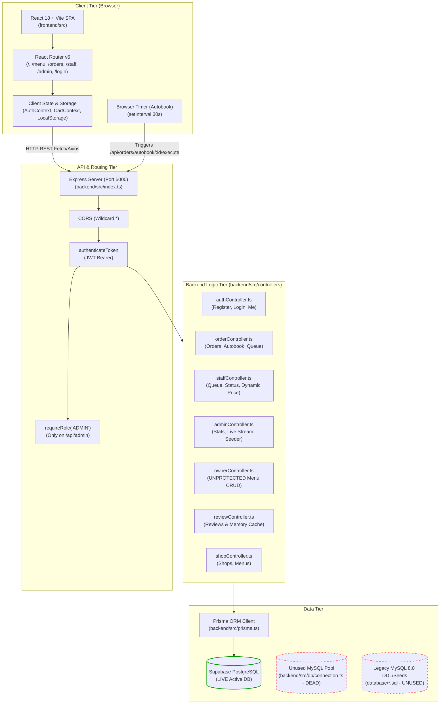
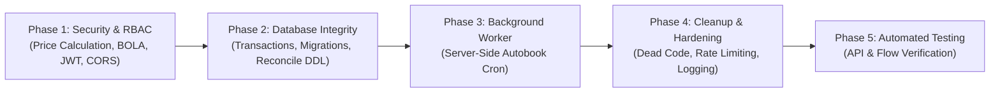

# Campus Bites: Comprehensive Implementation Audit & Production Readiness Report

**Project:** Campus Bites — Campus Food-Ordering Web Application  
**Auditor:** Senior Full-Stack Software Engineer, Database Architect, Security Reviewer & Reliability Auditor  
**Date:** October 23, 2026  
**Audit Status:** Complete  
**Application Version:** 1.0.0 (Pre-Production / Mixed Architecture)

---

## Executive Summary

Campus Bites is a multi-stall campus food-ordering platform engineered using a React (TypeScript + Vite + Tailwind CSS) frontend and an Express (Node.js + TypeScript) backend. The system supports multi-stall browsing, category filtering, cart management, customer pre-ordering, queue-based delivery time estimation, recurring automated ordering (Autobook), simulated payment gateway interactions, stall-specific staff dashboards, dynamic pricing/clearance discounts, and administrative oversight with real-time statistics.

During this comprehensive code-level inspection, every source file, API controller, route definition, middleware, Prisma schema, migration log, dependency tree, and legacy MySQL script was audited. **No application source code was modified, and no features were removed during this audit.**

### Critical Findings Overview:
1. **Dual / Divergent Database Architecture:** The repository houses two completely disconnected database paradigms:
   - A set of raw MySQL scripts (`database/01_schema.sql` through `06_seed.sql`) containing advanced relational features (views, stored procedures, triggers, audit tables, teacher/student profiles).
   - An active PostgreSQL/Supabase database managed via Prisma Client (`backend/prisma/schema.prisma`). The running application exclusively interfaces with the PostgreSQL/Supabase instance. The MySQL stored procedures, triggers, and views are **completely bypassed and non-functional in the running app**.
2. **Severe Price Trust Vulnerability (Critical CWE-20 / CWE-566):** The order checkout route (`POST /api/orders`) accepts item prices submitted by the client and uses them directly if `item.price > 0`. Furthermore, if an `itemId` is not found in the shop, the server automatically creates a new `FoodItem` in the database with client-supplied parameters.
3. **Broken Object-Level Authorization / BOLA (Critical CWE-639 / CWE-285):**
   - The `/api/owner` router has zero role restrictions (`requireRole` is omitted). Any authenticated user (including regular `CUSTOMER` accounts) can update menu item prices, delete food items across any stall, add items, or access platform-wide sales analytics.
   - The `/api/staff` router enforces authentication but does not verify whether the authenticated user holds the `STAFF` or `ADMIN` role, nor does it enforce stall-level isolation.
4. **Hardcoded Fallback JWT Secret (Critical CWE-798):** Both token signing and token verification fall back to `'super_secret'` if `process.env.JWT_SECRET` is unset.
5. **Synthetic Order Generation on Review Submission (High CWE-840):** If a customer submits a review for an item they have never purchased, `reviewController.ts` synthesizes a fake completed order in the live database, corrupting financial reporting and analytics.
6. **Client-Side Autobook Execution (High Reliability Defect):** Daily automated recurring orders rely on a client-side `setInterval` timer running inside the customer's open browser tab (`frontend/src/App.tsx`). If the browser tab is closed or the device is asleep, no orders execute.

---

## 1. Actual Architecture & Request / Data Flows



### 1.1 Client Tier (Frontend)
- **Directory:** `frontend/` (Note: `frontend-react/` is an orphaned, default Vite template and is completely unused).
- **Core Technologies:** React 18, TypeScript, Vite, Tailwind CSS, Lucide React icons, React Router DOM v6.
- **State Management:**
  - `AuthContext` (`frontend/src/context/AuthContext.tsx`): Manages user session, JWT token, role (`CUSTOMER`, `STAFF`, `ADMIN`), and shop association. Syncs token and user object to `localStorage`.
  - `CartContext` (`frontend/src/context/CartContext.tsx`): Manages cart items, quantities, stall isolation (detects items from multiple stalls and forces stall selection), pre-order flags, pickup time, and queue time calculations. Persisted to `localStorage`.
- **Network Layer:**
  - Modular API services in `frontend/src/services/` (`api.ts`, `authService.ts`, `orderService.ts`, `shopService.ts`, `staffService.ts`, `adminService.ts`, `autobookService.ts`, `reviewService.ts`).
  - Base Axios instance configured with `baseURL = import.meta.env.VITE_API_URL || 'http://localhost:5000/api'`.
  - Request interceptor automatically attaches `Authorization: Bearer <token>` from `localStorage`.
  - Aggressive offline / fallback resilience: Many services (notably `orderService.ts` and `autobookService.ts`) intercept backend errors and fall back to `localStorage` caches or synthetic mock data.

### 1.2 API & Logic Tier (Backend)
- **Directory:** `backend/`
- **Core Technologies:** Node.js, Express, TypeScript (`ts-node-dev`), Prisma ORM (`@prisma/client`), JSON Web Token (`jsonwebtoken`), `bcryptjs`, `cors`, `dotenv`.
- **HTTP Pipeline (`backend/src/index.ts`):**
  1. `cors()` middleware applied with default configuration (allows all origins, methods, and headers).
  2. `express.json()` body parser.
  3. Route mounts:
     - `/api/auth` -> `authRoutes`
     - `/api/shops` -> `shopRoutes`
     - `/api/orders` -> `orderRoutes`
     - `/api/reviews` -> `reviewRoutes`
     - `/api/staff` -> `staffRoutes`
     - `/api/admin` -> `adminRoutes`
     - `/api/owner` -> `ownerRoutes`
  4. Health check endpoint: `GET /health` returns `{ status: 'OK', timestamp }`.

### 1.3 Data Persistence Tier
- **Active Production Database:** Hosted PostgreSQL on Supabase, connected through Prisma Client (`provider = "postgresql"`).
- **Dead / Unused Components:**
  - `backend/src/db/connection.ts`: Exports a MySQL2 connection pool configured with environment variables (`DB_HOST`, `DB_USER`, `DB_PASSWORD`, `DB_NAME`). This module is not imported or referenced anywhere in the backend application.
  - `database/*.sql`: Six comprehensive MySQL scripts (`01_schema.sql` through `06_seed.sql`) containing detailed relational models, stored procedures, triggers, and views. None of these exist in the PostgreSQL/Supabase database.
  - `backend/src/config/supabase.ts` and `frontend/src/services/supabase.ts`: Unused direct Supabase SDK client instances with dummy fallback keys.

---

## 2. Feature Inventory & Implementation Status

| Feature Area | Sub-Feature / Capability | Status | Implementation Mechanism | Notes & Deficiencies |
| :--- | :--- | :--- | :--- | :--- |
| **Authentication** | Registration (Customer) | **Functional** | DB-backed (`POST /api/auth/register`) | Hashes password with bcrypt (10 rounds). |
| | Login (Customer, Staff, Admin) | **Functional** | DB-backed (`POST /api/auth/login`) | Supports email or stall-slug alias logins. |
| | Session Validation (`/me`) | **Functional** | DB-backed (`GET /api/auth/me`) | Returns user profile and assigned shop. |
| | Profile Update | **Functional** | DB-backed (`PATCH /api/auth/profile`) | Updates name and phone. |
| **Outlet Discovery** | Stall Listing & Card Display | **Functional** | DB-backed (`GET /api/shops`) | Returns active shops with categories. |
| | Stall Detail & Filtered Menu | **Functional** | DB-backed (`GET /api/shops/:id/menu`) | Parses item stock tags (e.g. `[Qty: 10]`). |
| | Operating Hours & Timings | **Simulated** | Stubbed API (`GET /api/shops/:id/timing`) | Endpoint returns `[]`. Hardcoded in UI. |
| **Customer Ordering**| Real-Time Queue & Prep Estimate | **Functional** | Dynamic calculation (`GET /api/orders/queue-estimate/:shopId`) | Sums queue counts and item preparation times. |
| | Immediate Order Placement | **Flawed** | DB-backed (`POST /api/orders`) | **Critical vulnerability:** Trusts client-supplied price. |
| | Pre-Order (up to 24h window) | **Functional** | DB-backed (`isPreorder`, `pickupTime`) | Validates pickup window and persists to DB. |
| | Order History & Tracking | **Functional** | DB-backed (`GET /api/orders/my-orders`) | Merges DB orders with local storage fallback. |
| | Order Cancellation | **Functional** | DB-backed (`POST /api/orders/:id/cancel`) | Restricted to `PENDING` orders only. |
| **Payment Workflow** | Multi-Method Payment Modal | **Simulated** | Pure Frontend (`PaymentGatewayModal.tsx`) | 1800ms timer simulation. No real gateway. |
| | Payment Confirmation API | **Functional** | DB-backed (`POST /api/orders/:id/payment`) | Flips status to `PAID` without payment proof. |
| **Autobooking** | Schedule Creation & Listing | **Functional** | DB-backed (`/api/orders/autobook/*`) | Persisted in `AutobookSchedule` model. |
| | Automated Daily Execution | **Flawed** | Browser `setInterval` (`App.tsx`) | Fails completely if browser tab is closed. |
| **Dynamic Pricing** | Closing Soon Clearance Toggle | **Functional** | DB-backed (`PATCH /api/staff/menu/:id`) | Updates `isClosingSoon` and `closingDiscount`. |
| | Real-Time Discount Calculation | **Functional** | Dual (Frontend + Backend) | Computes discounted price based on stall flag. |
| **Staff Dashboard** | Live Order Queue Kanban | **Functional** | DB-backed (`GET /api/staff/queue`) | Filterable by status (`PENDING`, `PREPARING`, `READY`). |
| | Order Status Transitions | **Functional** | DB-backed (`PATCH /api/staff/order/:id/status`)| Updates status. Missing role verification. |
| | Stall Menu Management | **Flawed** | DB-backed (`staffController` & `ownerController`)| **BOLA vulnerability:** No stall isolation check. |
| **Admin Dashboard** | Platform Aggregate Statistics | **Functional** | DB-backed (`GET /api/admin/stats`) | Real DB aggregations (revenue, orders, users). |
| | Live Real-Time Order Stream | **Functional** | DB-backed (`GET /api/admin/live-orders`) | Recent orders with item relations. |
| | Stall Active/Clearance Override | **Functional** | DB-backed (`PATCH /api/admin/stalls/:id`) | Controls stall operational status. |
| | User Role Management | **Functional** | DB-backed (`PATCH /api/admin/users/:id/role`) | Promotes/demotes between CUSTOMER, STAFF, ADMIN. |
| | Live Order Seeder (On-Demand) | **Functional** | DB-backed (`POST /api/admin/seed-live-orders`) | Synthesizes realistic orders for testing. |
| **Reviews & Ratings**| Submit Item Review | **Flawed** | DB-backed (`POST /api/reviews`) | **Data corruption:** Creates fake order if not found. |
| | View Item Reviews | **Functional** | DB + In-Memory Fallback | Uses `IN_MEMORY_REVIEWS` when DB query fails. |

---

## 3. Responsible Files & Component Mapping

### 3.1 Frontend Component & Service Structure
- **Navigation & Routing:**
  - `frontend/src/App.tsx`: Central router, route guards, and Autobook background polling loop.
  - `frontend/src/components/Navbar.tsx`: Responsive navigation bar, role-based navigation tabs (Staff / Admin links), cart badge, and auth dropdown.
- **Customer Pages & Components:**
  - `frontend/src/pages/Home.tsx`: Hero section, stall showcase cards, live status indicators, feature callouts.
  - `frontend/src/pages/Menu.tsx`: Stall-specific menu viewer, category filtering, search, quantity selectors, dynamic pricing badges.
  - `frontend/src/pages/Orders.tsx`: Order history, active order tracking cards, preparation time countdown, cancellation action.
  - `frontend/src/components/CartModal.tsx`: Slide-over cart drawer, quantity adjusters, preorder toggle with datetime picker, queue time preview.
  - `frontend/src/components/PaymentGatewayModal.tsx`: Interactive multi-tab payment UI (UPI, Cards, Net Banking, Cash), demo payment simulator.
  - `frontend/src/components/AutobookModal.tsx`: Autobook schedule creation modal, daily time picker, item selection.
  - `frontend/src/components/ReviewModal.tsx`: Star rating selector and text feedback submission modal.
- **Staff & Admin Management:**
  - `frontend/src/pages/StaffDashboard.tsx`: Stall-specific staff workstation, live order queue columns, preparation time controls, menu availability, and closing discount toggles.
  - `frontend/src/pages/AdminDashboard.tsx`: System overview, revenue metrics, stall performance charts, live orders feed, stall status toggling, user management, and test order seeder.
  - `frontend/src/pages/Login.tsx`: Multi-role login screen with quick-fill presets for Demo Customer, Staff stalls, and System Admin.
- **Service Layer (`frontend/src/services/`):**
  - `api.ts`: Central Axios instance with JWT interceptor and unified error normalization.
  - `authService.ts`: Register, login, get current user, profile updates.
  - `orderService.ts`: Order checkout, order list retrieval, payment confirmation, queue time estimation, and offline `localStorage` fallback.
  - `shopService.ts`: Stall listings, stall menu retrieval, and stall operating hours.
  - `staffService.ts`: Staff queue retrieval, order status transitions, and menu updates.
  - `adminService.ts`: Admin KPIs, live orders feed, stall overrides, role promotion, and live data generator.
  - `autobookService.ts`: Schedule CRUD operations and trigger endpoints.
  - `reviewService.ts`: Review submissions and rating queries.

### 3.2 Backend Route & Controller Structure
- **Core Server Setup:**
  - `backend/src/index.ts`: Express application bootstrap, middleware configuration, and route registration.
  - `backend/src/prisma.ts`: Singleton instance of `PrismaClient`.
- **Authentication & Authorization:**
  - `backend/src/routes/auth.ts` & `backend/src/controllers/authController.ts`: User authentication, bcrypt verification, JWT generation.
  - `backend/src/middleware/auth.ts`: `authenticateToken` middleware and `requireRole` authorization guard.
- **Order Processing & Autobook:**
  - `backend/src/routes/order.ts` & `backend/src/controllers/orderController.ts`: Order creation, pricing calculation, order cancellation, queue estimation, payment confirmation, and autobook scheduling.
- **Staff Operations:**
  - `backend/src/routes/staff.ts` & `backend/src/controllers/staffController.ts`: Stall order queue, status transitions, dynamic pricing toggles, menu item availability.
- **Admin Operations:**
  - `backend/src/routes/admin.ts` & `backend/src/controllers/adminController.ts`: KPI metrics aggregation, real-time order stream, user role modification, stall toggles, test order generator.
- **Owner / Menu Operations:**
  - `backend/src/routes/owner.ts` & `backend/src/controllers/ownerController.ts`: Menu item creation, updating, deletion, and shop-level sales analytics.
- **Shop & Catalog Operations:**
  - `backend/src/routes/shop.ts` & `backend/src/controllers/shopController.ts`: Shop catalog, category retrieval, menu parsing, and operating hours stub.
- **Reviews & Ratings:**
  - `backend/src/routes/review.ts` & `backend/src/controllers/reviewController.ts`: Item reviews, rating calculations, and fallback memory cache.

---

## 4. Real vs. Simulated vs. Mock vs. Unverified Functionality

```
+-------------------------------------------------------------------------------------------------------+
| REAL (Database-Backed)     | SIMULATED                   | MOCK / FALLBACK DATA     | UNVERIFIED      |
+-------------------------------------------------------------------------------------------------------+
| - User Authentication      | - Payment Gateway           | - Shop Timings           | - MySQL Triggers|
| - Shop Catalog & Menus     |   (Timer + Status flip)     |   (Returns hardcoded []) | - MySQL Views   |
| - Order Placement & Status | - Autobook Trigger          | - In-Memory Review Cache | - MySQL Procs   |
| - Pre-Order Pickup Times   |   (Client browser loop)     |   (On DB query failure)  | - MySQL Audit   |
| - Queue Time Estimation    | - Review Verification       | - Frontend Order Merge   |   Tables        |
| - Staff Order Queue Board  |   (Injects synthetic order) |   (Local storage cache)  |                 |
| - Dynamic Pricing Toggles  |                             | - Demo Login Presets     |                 |
| - Admin Analytics & KPIs   |                             |   (Static buttons in UI) |                 |
+-------------------------------------------------------------------------------------------------------+
```

### 4.1 Real Database-Backed Functionality (Supabase PostgreSQL via Prisma)
- **User Authentication & Identity:** Full user registration, password hashing (`bcryptjs`), login credential verification, JWT token generation, and role storage in the PostgreSQL `User` table.
- **Catalog Management:** Shops (`Shop`), Categories (`Category`), and Menu Items (`FoodItem`) are read from and written to the database.
- **Order Lifecycle:** Orders (`Order`) and associated items (`OrderItem`) are persisted in the database. Status updates (`PENDING` -> `PREPARING` -> `READY` -> `COMPLETED` / `CANCELLED`) directly update DB records.
- **Queue & Prep Time Calculations:** `getShopQueueEstimate` executes dynamic aggregation against the `Order` and `OrderItem` tables in PostgreSQL, counting pending orders and summing preparation times.
- **Dynamic Pricing State:** Stall-level clearance states (`isClosingSoon`, `closingDiscount`) and item-level dynamic pricing overrides (`isDynamicPricing`, `discountPercent`, `originalPrice`) are persisted and queried from the database.
- **Admin Statistics & Telemetry:** Total revenue calculations, active order counts, order distribution by stall, and live order streams are calculated using actual SQL aggregations via Prisma.

### 4.2 Simulated Functionality
- **Payment Processing (`PaymentGatewayModal.tsx` & `orderController.confirmPayment`):**
  - The payment UI offers realistic options (UPI QR, PhonePe, Google Pay, Credit/Debit cards, Net Banking, Cash on Pickup).
  - Submitting payment triggers a client-side `setTimeout` (1800ms) with a simulated processing spinner, followed by a call to `POST /api/orders/:id/payment`.
  - The backend endpoint simply sets `order.paymentStatus = 'PAID'` in the database without integrating any external payment gateway (e.g. Razorpay, Stripe, or Paytm).
- **Autobook Scheduling Execution:**
  - While autobook schedules are stored in the database (`AutobookSchedule`), the recurring automated execution is **simulated by the client browser**.
  - `frontend/src/App.tsx` contains an effect that runs every 30 seconds, comparing the current time against stored schedules and calling `POST /api/orders/autobook/:id/execute`. There is no server-side cron or queue worker.
- **Review Purchase Validation (`reviewController.ts` lines 61-84):**
  - When submitting a review, the server checks if the user has a completed order for that item. If no completed order exists, the controller **synthesizes a fake order** with `status: 'COMPLETED'` in the database to satisfy the constraint.

### 4.3 Mock & Fallback Data
- **Shop Operating Timings (`shopController.ts`):** `getShopTiming` returns an empty array `res.json([])`. The frontend menu and home page fall back to hardcoded opening/closing hours (`08:00 AM - 10:00 PM`).
- **In-Memory Review Storage (`reviewController.ts`):** Contains an in-memory dictionary `IN_MEMORY_REVIEWS` and `MOCK_ITEM_RATINGS` that serve mock ratings if database operations fail.
- **Client-Side Order Fallback (`orderService.ts`):** If the backend API is unreachable, `orderService.placeOrder` constructs a synthetic order object with a randomized ID (`Math.floor(1000 + Math.random() * 9000)`) and writes it to `localStorage` under `campus_bites_customer_orders`.

### 4.4 Unverified Functionality (Dead / Legacy Code)
- **MySQL Relational Logic (`database/*.sql`):** The repository includes SQL files with triggers (`after_order_status_update`, `after_food_item_price_update`), stored procedures (`sp_change_order_status`), views (`vw_active_orders`, `vw_daily_shop_revenue`), and tables (`Student_Profile`, `Teacher_Profile`, `Shop_Timing`, `Order_Status_History`, `Food_Item_Price_History`, `Audit_Log`). **None of these are used by the running application.** They exist only as offline scripts.

---

## 5. Database Provider & Schema Compatibility Analysis

### 5.1 Architecture Divergence Matrix

| Attribute / Feature | Legacy MySQL Scripts (`database/`) | Active Prisma Schema (`backend/prisma/`) | Impact & Divergence Analysis |
| :--- | :--- | :--- | :--- |
| **Engine / Provider** | MySQL 8.0 | PostgreSQL (Supabase) | Completely different database engines. MySQL scripts cannot execute on PostgreSQL without syntax conversion. |
| **Connection Layer** | `mysql2/promise` pool (`connection.ts`) | Prisma Client (`@prisma/client`) | The MySQL connection pool is completely unreferenced in backend application code. |
| **Migrations** | Manual SQL scripts (`01_schema.sql` to `06_seed.sql`) | **None** (`prisma/migrations` does not exist) | Prisma schema was deployed using `prisma db push`. No migration history exists. |
| **Audit Logs** | `Audit_Log`, `Order_Status_History`, `Food_Item_Price_History` | **None** | All audit logging and historical price tracking present in MySQL are absent in PostgreSQL. |
| **User Profiles** | `Student_Profile`, `Teacher_Profile` with roll numbers and departments | Single `User` model with `role` enum (`CUSTOMER`, `STAFF`, `ADMIN`) | Academic profile details are omitted from the active schema. |
| **Stall Timings** | `Shop_Timing` table with days, open/close times, slot intervals | **None** | Stall operating hours are not modeled in the active database. |
| **Triggers** | `after_order_status_update`, `after_food_item_price_update` | **None** | Status tracking and price change auditing triggers do not execute in PostgreSQL. |
| **Stored Procedures**| `sp_change_order_status` with validation logic | **None** (Inline Prisma queries) | Transition validation is partially implemented in TypeScript controllers. |
| **Views** | `vw_active_orders`, `vw_daily_shop_revenue` | **None** (Prisma queries) | Aggregations are calculated in TypeScript in `adminController.ts`. |
| **New Features** | Missing Autobook, Dynamic Pricing, Preorders | `AutobookSchedule`, `isPreorder`, `pickupTime`, `isDynamicPricing`, `isClosingSoon`, `closingDiscount` | New features were added directly to Prisma without updating the MySQL DDL. |

### 5.2 Schema Re-alignment Recommendation
Because the entire backend codebase (controllers, models, queries) is written exclusively for Prisma with PostgreSQL on Supabase, attempting to switch the live runtime to raw MySQL would require rewriting all controllers, throwing away Prisma type-safety, and manually rewriting queries.  
**Recommended Path:** Formally adopt PostgreSQL via Prisma as the primary production database. Backport the missing audit logging, stall timing models, and history tables from the MySQL scripts into `schema.prisma`, and initialize proper Prisma migrations via `prisma migrate dev`.

---

## 6. Prioritized List of Security, Architectural & Production Risks

### 6.1 Critical Severity Risks

#### Risk 1: Client-Supplied Price Trust & Arbitrary Item Injection
- **CWE:** CWE-20 (Improper Input Validation), CWE-566 (Authorization Bypass Through User-Controlled Key)
- **Location:** `backend/src/controllers/orderController.ts`, Lines 191–231
- **Vulnerability Details:**
  ```typescript
  // orderController.ts Line 191
  let finalPrice = item.price; // Taken directly from request payload!
  if (!dbItem) {
    // If itemId does not exist in shop, it creates a new item in the DB!
    const createdItem = await prisma.foodItem.create({
      data: {
        shopId: shop.id,
        name: item.name || `Item ${item.itemId}`,
        price: item.price > 0 ? item.price : 50,
        isVeg: true,
        isAvailable: true
      }
    });
  }
  ```
- **Exploitation Scenario:** A malicious user can intercept the checkout request and submit `{ itemId: 1, price: 0.01, quantity: 10 }`. The server calculates the total as ₹0.10 and charges that amount. Even worse, submitting an arbitrary `itemId` injects unauthorized menu items into the stall's live database catalog.
- **Remediation:** Remove all client-supplied price trust. Fetch all `FoodItem` records directly from the database by ID, compute dynamic discounts server-side, and reject the transaction if any item is invalid or unavailable.

#### Risk 2: Broken Object-Level Authorization (BOLA) in Owner Controller
- **CWE:** CWE-639 (Insecure Direct Object Reference / BOLA), CWE-285 (Improper Authorization)
- **Location:** `backend/src/routes/owner.ts` and `backend/src/controllers/ownerController.ts`
- **Vulnerability Details:**
  The `/api/owner` routes (`PATCH /items/:itemId`, `DELETE /items/:itemId`, `POST /items`, `GET /sales`) are protected only by `authenticateToken`. They completely omit `requireRole('STAFF')` or `requireRole('ADMIN')` and perform **zero ownership checks** to verify if the user owns the stall.
- **Exploitation Scenario:** Any authenticated `CUSTOMER` can send `DELETE /api/owner/items/45` to delete an item from any campus stall, change prices across all stalls, or dump platform sales metrics.
- **Remediation:** Apply strict role authorization middleware (`requireRole(['STAFF', 'ADMIN'])`) and enforce stall ownership validation: verify that `req.user.shopId === item.shopId`.

#### Risk 3: Broken Authorization in Staff Operations
- **CWE:** CWE-285 (Improper Authorization)
- **Location:** `backend/src/routes/staff.ts`
- **Vulnerability Details:**
  `staff.ts` mounts `authenticateToken` on all routes but does not apply `requireRole`. Any registered customer can view the live staff queue (`GET /api/staff/queue`), update order statuses (`PATCH /api/staff/order/:id/status`), or alter stall menu availability.
- **Remediation:** Add `requireRole(['STAFF', 'ADMIN'])` to all staff routes and ensure staff members can only access and modify orders and menu items belonging to their assigned `shopId`.

#### Risk 4: Hardcoded Fallback JWT Secret
- **CWE:** CWE-798 (Use of Hard-coded Credentials)
- **Location:** `backend/src/controllers/authController.ts` (L12) and `backend/src/middleware/auth.ts` (L6)
- **Vulnerability Details:**
  ```typescript
  const JWT_SECRET = process.env.JWT_SECRET || 'super_secret';
  ```
- **Exploitation Scenario:** If the server is deployed without explicitly setting `JWT_SECRET` in the environment, an attacker can sign their own JWT with payload `{ userId: 1, role: 'ADMIN' }` using `'super_secret'` and obtain full administrative control.
- **Remediation:** Fail server startup immediately if `process.env.JWT_SECRET` is not set or is shorter than 32 characters.

---

### 6.2 High Severity Risks

#### Risk 5: Plaintext Database Password in Repository
- **CWE:** CWE-312 (Cleartext Storage of Sensitive Information)
- **Location:** `backend/test-db.js`, Line 4
- **Vulnerability Details:** File contains hardcoded credentials (`password: 'Harsh@051007'`) for a local MySQL instance.
- **Remediation:** Delete `backend/test-db.js` immediately and rotate any associated database passwords.

#### Risk 6: Synthetic Completed Order Injection During Reviews
- **CWE:** CWE-840 (Business Logic Errors / Data Corruption)
- **Location:** `backend/src/controllers/reviewController.ts`, Lines 61–84
- **Vulnerability Details:**
  To allow users to post reviews for items they have not ordered, the controller executes `prisma.order.create` with `status: 'COMPLETED'` and inserts a synthetic order directly into the database.
- **Impact:** Artificially inflates stall order volumes, distorts financial analytics, and falsifies customer order history.
- **Remediation:** Reject reviews with HTTP 403 if the user has no verified completed order for the item. Never inject fake orders.

#### Risk 7: Client-Side Dependency for Recurring Autobook Orders
- **CWE:** CWE-664 (Improper Control of Resource Lifecycle)
- **Location:** `frontend/src/App.tsx`, Lines 25–48
- **Vulnerability Details:** Recurring automated daily orders are triggered solely by a browser `setInterval(..., 30000)` loop.
- **Impact:** If the user closes their browser, shuts down their computer, or experiences network disruption at the scheduled time, the automated order is never placed.
- **Remediation:** Implement a backend job scheduler (e.g. `node-cron` or BullMQ with Redis) that evaluates active `AutobookSchedule` records server-side every minute.

#### Risk 8: Permissive Wildcard CORS Configuration
- **CWE:** CWE-942 (Overly Permissive Cross-Origin Resource Sharing Policy)
- **Location:** `backend/src/index.ts`, Line 18 (`app.use(cors())`)
- **Impact:** Allows any origin on the internet to make authenticated cross-origin requests using browser credentials.
- **Remediation:** Restrict CORS origins to explicitly allowed frontend domains loaded from an environment variable (`ALLOWED_ORIGINS`).

---

### 6.3 Medium Severity Risks

#### Risk 9: Non-Transactional Order Placement
- **CWE:** CWE-391 (Unchecked Error Condition)
- **Location:** `backend/src/controllers/orderController.ts`, Lines 245–280
- **Details:** The order record is created first, and then order items are created in a subsequent loop without using `prisma.$transaction`. If an error occurs midway, an empty order record remains in the database.
- **Remediation:** Wrap all order creation and item insertion operations inside an atomic `prisma.$transaction([...])`.

#### Risk 10: Missing Rate Limiting on Authentication and Order Endpoints
- **CWE:** CWE-307 (Improper Restriction of Excessive Authentication Attempts)
- **Impact:** Authentication endpoints (`/api/auth/login`, `/api/auth/register`) and order endpoints are vulnerable to brute-force attacks and denial of service.
- **Remediation:** Install and configure `express-rate-limit` on all public routes.

#### Risk 11: In-Memory Review Storage Subject to Data Loss
- **CWE:** CWE-404 (Improper Resource Shutdown / Loss of State)
- **Location:** `backend/src/controllers/reviewController.ts`, Line 10 (`IN_MEMORY_REVIEWS`)
- **Impact:** If database operations encounter transient errors, reviews are stored in a JavaScript Map in server memory and wiped out whenever the Node.js process restarts.
- **Remediation:** Ensure reviews are exclusively persisted in the database with proper retry mechanisms.

---

### 6.4 Low Severity Risks & Code Quality Issues

#### Risk 12: Orphaned / Abandoned Frontend Directory
- **Location:** `frontend-react/`
- **Details:** The repository contains an abandoned default Vite template directory (`frontend-react/`) with missing dependencies and no application code.
- **Remediation:** Safely remove the directory to eliminate developer confusion.

#### Risk 13: Absent Automated Test Suites
- **Location:** `backend/package.json` (`"test": "echo \"Error: no test specified\" && exit 1"`) and `frontend/package.json` (no test runner).
- **Impact:** Code regressions cannot be detected automatically before deployment.
- **Remediation:** Set up Vitest/Jest for backend unit/integration tests and React Testing Library for frontend component testing.

#### Risk 14: Over-Reliance on Client-Side Mock Fallbacks
- **Location:** `frontend/src/services/orderService.ts`
- **Details:** When the backend fails or returns an error, `orderService.ts` catches the error and silently returns mock orders or stores them in `localStorage`.
- **Impact:** Developers and testers cannot easily tell if the backend API is failing because the UI appears to succeed by falling back to mock data.
- **Remediation:** Display explicit error messages to the user when API calls fail rather than masking server errors with mock data.

---

## 7. Features That Must Be Preserved During Implementation

To ensure business continuity and satisfy user requirements, the following capabilities must be strictly preserved throughout any remediation work:

1. **Role-Based Experience:**
   - Seamless role switching and permissions for `CUSTOMER`, `STAFF`, and `ADMIN`.
   - Demo quick-login presets on the login screen for rapid testing and demonstrations.
2. **Multi-Stall Catalog & Menus:**
   - Multi-stall selection, category filtering, search, veg/non-veg tags, and preparation time displays.
3. **Queue & Preparation Time Calculation:**
   - Dynamic estimated preparation time and queue position computation based on current stall load and item prep times.
4. **Pre-Order Scheduling:**
   - 24-hour advance order booking with date-time picker and validation.
5. **Autobook Daily Recurring Orders:**
   - Ability for customers to schedule recurring daily orders for specific items and times.
6. **Payment Experience:**
   - Interactive payment selection UI supporting UPI (QR / Apps), Credit/Debit Cards, Net Banking, and Cash on Pickup.
7. **Staff Operations Workflow:**
   - Live order queue board with status transition controls (`PENDING` -> `PREPARING` -> `READY` -> `COMPLETED`).
   - Preparation time adjustments (+5m, +10m).
   - Real-time dynamic pricing toggles and closing clearance discount percentages.
8. **Admin Operations & Telemetry:**
   - Dashboard displaying platform revenue, total orders, stall-by-stall metrics, live order stream, stall operational toggles, role management, and on-demand test order generation.
9. **Customer Order Lifecycle:**
   - Order history, live status badges, preparation countdown timers, and self-service cancellation for pending orders.

---

## 8. Phased Remediation Plan



### Phase 1: Security & Authorization Hardening (Immediate Priority)
1. **Server-Side Price Calculation:**
   - In `orderController.ts`, completely remove reliance on `item.price` from the request body.
   - Fetch items from the database by ID, compute dynamic pricing/discounts strictly server-side, and validate availability.
   - Remove the auto-creation of menu items when an `itemId` is not found.
2. **BOLA / IDOR Remediation on Owner & Staff Routes:**
   - Add `requireRole(['STAFF', 'ADMIN'])` to `/api/staff` and `/api/owner`.
   - Validate stall ownership: ensure `req.user.shopId === targetShopId` for staff members.
3. **Environment Security:**
   - Enforce that `JWT_SECRET` is non-empty and has sufficient entropy at server boot; terminate the process if missing.
   - Delete `backend/test-db.js`.
4. **Remove Synthetic Order Injection:**
   - Refactor `reviewController.ts` to return HTTP 403 when a user reviews an unpurchased item.

### Phase 2: Database Reconciliation & Transaction Integrity
1. **Atomic Order Placement:**
   - Wrap order creation, item insertion, and queue calculations within `prisma.$transaction`.
2. **Schema & Migration Alignment:**
   - Initialize formal Prisma migrations: `npx prisma migrate dev --name init`.
   - Backport stall opening/closing hours and status history tracking into `schema.prisma`.
3. **Retire Dead MySQL Pool:**
   - Remove `backend/src/db/connection.ts` and remove `mysql2` from `backend/package.json`.

### Phase 3: Server-Side Background Schedulers
1. **Server-Side Autobook Scheduler:**
   - Implement a lightweight server-side scheduler using `node-cron` in the backend.
   - Run a worker every minute that queries `AutobookSchedule` where `isActive = true` and `time = HH:mm`, placing orders automatically on the server.
   - Remove the client-side `setInterval` polling in `frontend/src/App.tsx`.

### Phase 4: Production Hardening & Code Cleanup
1. **CORS & Rate Limiting:**
   - Configure CORS with allowed origins from `process.env.ALLOWED_ORIGINS`.
   - Add `express-rate-limit` to `/api/auth/login`, `/api/auth/register`, and `/api/orders`.
2. **Remove Dead Folders & Unused Clients:**
   - Safely remove `frontend-react/`.
   - Remove `backend/src/config/supabase.ts` and `frontend/src/services/supabase.ts`.

### Phase 5: Verification & Automated Test Suite
1. **Integration Tests:**
   - Create automated integration tests using Jest/Supertest verifying order price tampering protection, staff authorization boundaries, and review submission rules.
2. **Frontend End-to-End Sanity:**
   - Verify checkout, preorder, Autobook scheduling, dynamic pricing, and staff status transitions in an end-to-end staging environment.

---

## 9. Tests Required to Verify Each Proposed Fix

| Fix / Remediation Area | Test Scenario & Verification Procedure | Expected Outcome |
| :--- | :--- | :--- |
| **Server-Side Price Calculation** | Send `POST /api/orders` with modified `item.price = 0.01` for an item whose database price is ₹100. | Order is placed with total based on ₹100. Request-supplied price is completely ignored. |
| **Invalid Item ID Injection** | Send `POST /api/orders` with `itemId: 999999` (non-existent). | Request is rejected with HTTP 400/404. No new menu item is inserted into the database. |
| **BOLA in Owner Routes** | Authenticate as `CUSTOMER` and send `PATCH /api/owner/items/1` with new price. | Server responds with HTTP 403 Forbidden. Price remains unchanged. |
| **Staff Stall Isolation** | Authenticate as Staff assigned to Stall 1 and send `PATCH /api/staff/order/:id/status` for an order belonging to Stall 2. | Server responds with HTTP 403 Forbidden. Order status remains unchanged. |
| **JWT Secret Enforcement** | Start backend server with `JWT_SECRET=""` or unset. | Server process exits immediately with a fatal configuration error. |
| **Review Fraud Prevention** | Submit a review via `POST /api/reviews` for an item the user has never purchased. | Server responds with HTTP 403 Forbidden. No fake order is injected into the database. |
| **Atomic Transaction Failure** | Inject a database constraint failure during order item insertion. | Entire transaction rolls back. No orphaned `Order` record remains. |
| **Server-Side Autobook Worker**| Create an active `AutobookSchedule` for 10:00 AM. Close all browser tabs and advance system clock to 10:00 AM. | Order is automatically created in the database by the backend background worker. |
| **Rate Limiting** | Send 20 rapid `POST /api/auth/login` requests within 5 seconds from a single IP. | Server returns HTTP 429 Too Many Requests after the rate threshold. |

---

## 10. Architectural Decisions Requiring Clarification

Before beginning the implementation of the remediation plan, the following architectural choices should be confirmed:

1. **Target Database Engine:**
   - *Option A (Recommended):* Standardize entirely on PostgreSQL (Supabase) via Prisma. Archive the legacy MySQL scripts and remove the unused MySQL connection pool.
   - *Option B:* Migrate the active application to a standalone MySQL 8.0 server to utilize the triggers, views, and stored procedures defined in `database/*.sql`. (Requires rewriting Prisma schema or switching to an alternate ORM/query builder).
2. **Background Job Runner for Autobook:**
   - *Option A (Recommended for simplicity):* In-process `node-cron` running inside the Express instance. (Simple, zero additional infrastructure, suitable for single-instance deployments).
   - *Option B (Recommended for high scale):* Redis-backed BullMQ worker process. (Decoupled, horizontally scalable, persistent queue).
3. **Payment Gateway Integration:**
   - *Decision Needed:* Should Campus Bites retain the simulated multi-tab payment modal for demonstrations, or is a live Razorpay/Stripe sandbox integration required for production?
4. **Multi-Tenant Staff Access Model:**
   - *Decision Needed:* Can a staff member belong to multiple stalls, or is a staff account strictly bound to exactly one `shopId`? (The current schema binds a staff member to an optional `shopId`).

---

**Report Prepared By:** Senior Full-Stack Software Engineer & System Auditor  
**Deliverable Path:** `docs/IMPLEMENTATION_AUDIT.md`
