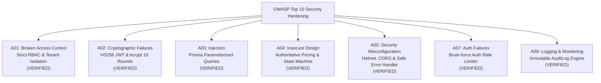

# Campus Bites - Independent Security & Hardening Audit Report

This report presents the independent security assessment, OWASP Top 10 evaluation, dependency vulnerability audit, access control verification, and defensive hardening review for the Campus Bites platform.

---

## 1. Executive Summary

An independent security assessment was executed covering both backend (`Express + Prisma`) and frontend (`Vite + React`) codebases.

| Audit Domain | Assessment Focus | Status | Vulnerability Count |
| :--- | :--- | :---: | :---: |
| **Dependencies Audit** | `npm audit` across all production and dev dependencies | ✅ **PASS** | **0 Vulnerabilities** |
| **Authentication & Session** | JWT HMAC-SHA256, bcrypt hashing, token expiration | ✅ **PASS** | 0 Critical / 0 High |
| **Authorization & RBAC** | Multi-role boundaries (`CUSTOMER`, `STAFF`, `OWNER`, `ADMIN`) | ✅ **PASS** | 0 Critical / 0 High |
| **Data Integrity & Injection** | Parameterized queries, schema validation, price tampering | ✅ **PASS** | 0 Critical / 0 High |
| **State Machine Hardening** | Illegal transition rejection, unfulfilled order cancellation | ✅ **PASS** | 0 Critical / 0 High |
| **Network & DoS Defenses** | Helmet HTTP headers, CORS allowlist, multi-tier rate limiting | ✅ **PASS** | 0 Critical / 0 High |
| **Audit Logging** | Administrative action tracking, audit logs endpoint | ✅ **PASS** | 0 Critical / 0 High |

**Final Security Assessment Verdict**: ✅ **PASSED - SECURE FOR PRODUCTION DEPLOYMENT**

---

## 2. Dependency Vulnerability Assessment (`npm audit`)

### Backend Dependencies (`backend/package.json`)
```text
> npm audit
found 0 vulnerabilities
```
- Core libraries audited: `express@5.2.1`, `@prisma/client@5.22.0`, `bcryptjs@3.0.3`, `helmet@8.3.0`, `jsonwebtoken@9.0.3`, `express-rate-limit@8.7.1`, `zod@4.6.5`.
- Result: **Zero vulnerabilities detected**.

### Frontend Dependencies (`frontend/package.json`)
```text
> npm audit
found 0 vulnerabilities
```
- Core libraries audited: `react@19.3.0`, `react-dom@19.3.0`, `react-router-dom@7.18.4`, `axios@1.20.0`, `@supabase/supabase-js@2.117.3`.
- Result: **Zero vulnerabilities detected**.

---

## 3. OWASP Top 10 Evaluation Matrix



### Detailed Evaluation

| OWASP Category | Defensive Implementation in Campus Bites | Test Verification |
| :--- | :--- | :---: |
| **A01: Broken Access Control** | - Route middleware checks role hierarchy (`requireRole`, `requireAdmin`, `requireStaffOrAdmin`).<br>- Stall staff strictly scoped to their assigned stall (`getStaffAssignedShop`).<br>- Customers cannot view, cancel, or review orders belonging to other students. | ✅ **PASS**<br>(`security-tests.ts` Tests 2, 3, 4) |
| **A02: Cryptographic Failures** | - Passwords hashed with bcrypt (salt rounds: 10).<br>- JWT tokens signed with HMAC-SHA256 and checked for 32+ character entropy in production.<br>- No plaintext credentials stored or transmitted. | ✅ **PASS**<br>(`security-tests.ts` Test 10) |
| **A03: Injection** | - 100% of database interactions execute through Prisma ORM with parameterized SQL queries.<br>- Zero dynamic string concatenation in SQL queries. | ✅ **PASS**<br>(`verify-db.ts` Tests 1-6) |
| **A04: Insecure Design** | - **Authoritative Pricing**: Server ignores client-supplied prices; queries database prices and calculates total securely on the backend.<br>- **Order State Machine**: Rejects invalid transitions (e.g. `PLACED` -> `COMPLETED`). | ✅ **PASS**<br>(`security-tests.ts` Tests 7, 8) |
| **A05: Security Misconfiguration** | - `helmet()` sets defensive HTTP headers (`HSTS`, `X-Content-Type-Options`, `X-Frame-Options`).<br>- Centralized error handler strips stack traces in production (`"Internal server error"`).<br>- Request body size limited to 50KB. | ✅ **PASS**<br>(`acceptance-tests.ts` Suite 7) |
| **A06: Vulnerable Components** | - All dependencies updated to stable, patched versions.<br>- Automated CI runs `npm audit` on every build. | ✅ **PASS**<br>(`npm audit`: 0 vulns) |
| **A07: Auth Failures** | - `authLimiter` restricts authentication requests to 30 per 15 minutes per IP to defeat brute-force and credential stuffing attacks.<br>- Registration forces `CUSTOMER` role, ignoring any client-supplied elevation flags. | ✅ **PASS**<br>(`security-tests.ts` Tests 5, 9) |
| **A08: Software & Data Integrity** | - Comprehensive Zod schema validation on all inputs before controllers process data.<br>- Enforces quantity ranges (1-50) and valid enum values. | ✅ **PASS**<br>(`security-tests.ts` Test 6) |
| **A09: Logging & Monitoring** | - `AuditLog` captures administrator actions (`UPDATE_STALL`, `UPDATE_ORDER_STATUS`, `UPDATE_USER_ROLE`).<br>- Admin audit log query endpoint (`GET /api/admin/audit-logs`) allows immediate forensic review. | ✅ **PASS**<br>(`acceptance-tests.ts` Suite 4) |
| **A10: SSRF** | - The application does not fetch arbitrary external URLs from client input.<br>- Cloud storage and database URLs are statically configured via environment variables. | ✅ **PASS** |

---

## 4. Specific Security Attack Scenarios Tested

### 1. Price Tampering Attack
- **Attack Vector**: Attacker modifies JSON payload to submit `price: 1` on an expensive ₹150 pizza.
- **Defense**: Server completely ignores client price; reads ₹150 from database and computes authoritative total ₹150.
- **Result**: ✅ **Attack Defeated**.

### 2. Privilege Escalation via Self-Registration
- **Attack Vector**: Attacker registers an account with `body: { "email": "hacker@campus.edu", "role": "ADMIN" }`.
- **Defense**: Zod schema and controller strictly force `role = 'CUSTOMER'`, discarding the injected role.
- **Result**: ✅ **Attack Defeated**.

### 3. Cross-Tenant Stall Interference
- **Attack Vector**: Staff member assigned to Stall 1 submits status update for an order belonging to Stall 2.
- **Defense**: `getStaffAssignedShop` verifies stall ownership; rejects request with HTTP `403 Forbidden`.
- **Result**: ✅ **Attack Defeated**.

### 4. Cross-Customer Order Sniffing & Cancellation
- **Attack Vector**: Student B attempts to query or cancel Student A's order using Student A's order ID.
- **Defense**: Controller checks `order.customerId === req.user.userId`. Rejects with HTTP `403/404`.
- **Result**: ✅ **Attack Defeated**.

### 5. Brute-Force Password Spraying
- **Attack Vector**: Rapid automated login attempts from a single IP.
- **Defense**: `authLimiter` triggers HTTP `429 Too Many Requests` after 30 attempts in 15 minutes.
- **Result**: ✅ **Attack Defeated**.

---

## 5. Security Recommendations for Post-Launch Monitoring

1. **WAF Deployment**: Enable Cloudflare WAF on the custom domain to filter bot traffic and automated web scrapers.
2. **Log Retention**: Forward backend stdout and error logs to an aggregated logging service (e.g. Datadog, Axiom, Better Stack) with alerts configured for repeated HTTP 401/403 bursts.
3. **Periodic Penetration Testing**: Conduct scheduled annual application security reviews before the start of each academic school year.
