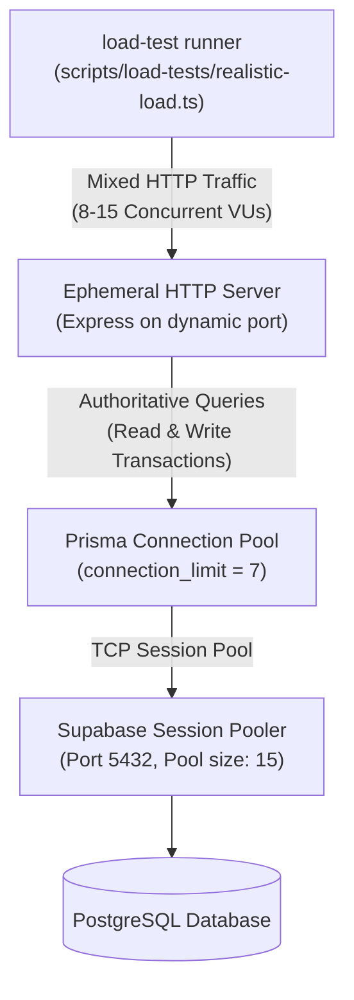

# Campus Bites - Load Testing & Simulation Guide

This document details the load testing methodology, architecture, workload profiles, execution instructions, and metrics analysis for the Campus Bites platform.

---

## 1. Objectives & Testing Philosophy

The primary goals of the Campus Bites load testing framework are:
1. **Realistic Student & Kitchen Traffic Simulation**: Replicate peak-hour campus dining traffic patterns where multiple students browse food courts, inspect live stall menus, checkout food orders, and kitchen staff actively query and transition order queues.
2. **Authoritative Latency & Throughput Measurement**: Measure end-to-end round-trip latencies (Minimum, Median/p50, Average, p90, p95, p99, Maximum) and total throughput (Requests Per Second - RPS).
3. **Database Connection Pool Stress Analysis**: Validate Prisma connection pooling behavior under concurrent database queries against remote PostgreSQL (Supabase).
4. **Zero State Pollution**: Automatically generate isolated test orders and fixtures, execute workload scenarios, and safely prune all generated records upon test completion.

---

## 2. Load Test Architecture



The load test suite uses an ephemeral in-process Node.js HTTP server dynamically bound to port `0` (allocates an available kernel port). This tests the entire application stack:
- HTTP server socket handling
- Express routing & middleware execution (CORS, Helmet, Body parsing)
- JWT signature decoding and role verification
- Zod request schema validation
- Prisma interactive transaction execution (`$transaction`)
- Live cloud database reads/writes over PostgreSQL network sockets

---

## 3. Realistic Workload Profile

Campus food courts experience non-uniform operational traffic. The runner uses a weighted probability distribution simulating authentic campus dining behavior:

| Operation | Weight | Endpoint | HTTP Method | Auth Required | Description |
| :--- | :---: | :--- | :---: | :---: | :--- |
| **Browse Outlets** | 40% | `/api/shops` | `GET` | No | Students scanning all available stalls and their closing clearance statuses. |
| **View Stall Menu** | 30% | `/api/shops/:shopId` | `GET` | No | Students viewing item prices, dynamic pricing discounts, and categories. |
| **Staff Queue Check** | 15% | `/api/staff/orders` | `GET` | Yes (STAFF) | Kitchen display terminals refreshing incoming live student orders. |
| **Place Real Orders** | 15% | `/api/orders` | `POST` | Yes (CUSTOMER) | Students completing checkout with menu items, triggering DB transactions and payment attempts. |

---

## 4. Rate Limiting in Load Tests

Campus Bites enforces strict production rate limiters (e.g. `authLimiter: 30/15min`, `orderLimiter: 20/min`, `generalLimiter: 400/15min`). During load tests:
- The runner injects `process.env.DISABLE_RATE_LIMIT = 'true'`.
- All requests include the `x-load-test: bypass` header.
- This allows testing raw database throughput and server compute capacity without artificial HTTP 429 throttling.

---

## 5. Execution Instructions

### Running the Load Test
From the backend directory:
```bash
npm run test:load
```
Or with direct tsx invocation:
```bash
npx tsx scripts/load-tests/realistic-load.ts
```

### Configurable Test Parameters
In `backend/scripts/load-tests/realistic-load.ts`:
```typescript
const TOTAL_REQUESTS = 160;  // Total operations executed in benchmark run
const CONCURRENCY = 8;        // Number of concurrent virtual worker threads
```

---

## 6. Metrics Captured

The test runner tracks high-resolution timing using Node's `performance.now()`:

- **Total Requests Processed**: Cumulative operations successfully dispatched and answered.
- **Test Duration**: Wall-clock duration in seconds.
- **Throughput (RPS)**: `Total Requests / Total Duration (sec)`.
- **Error Count & Rate**: Count of non-2xx/3xx HTTP responses and network exceptions.
- **Percentile Latencies**:
  - `p50 (Median)`: Typical latency experienced by 50% of users.
  - `p90`: Latency threshold encompassing 90% of requests.
  - `p95`: Production SLA standard metric for high-load tail latency.
  - `p99`: Peak outlier latency.
  - `Min` / `Max` / `Average`.
- **Per-Operation Breakdown**: Individual count, error rate, median, and p95 for each operation.

---

## 7. Automated Teardown & Data Sanitization

To guarantee zero database pollution:
1. Every order created during the simulation records its `orderId` in an ephemeral array `createdOrderIds`.
2. In the `finally` block of the runner, all test entities are purged in reverse foreign-key dependency order:
   ```typescript
   await prisma.orderItem.deleteMany({ where: { orderId: { in: createdOrderIds } } });
   await prisma.paymentAttempt.deleteMany({ where: { orderId: { in: createdOrderIds } } });
   await prisma.order.deleteMany({ where: { id: { in: createdOrderIds } } });
   ```
3. The ephemeral HTTP server socket is closed and the Prisma connection is gracefully disconnected.
