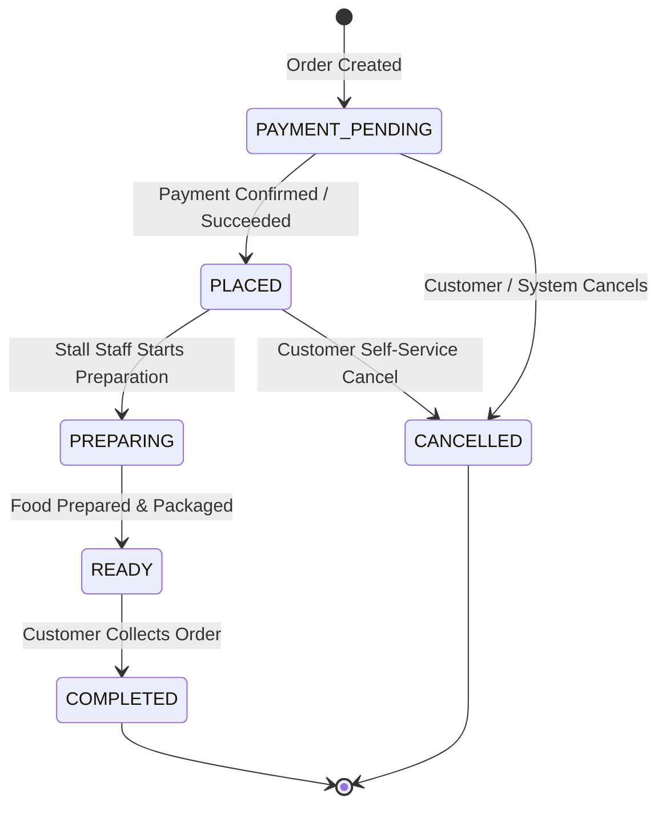
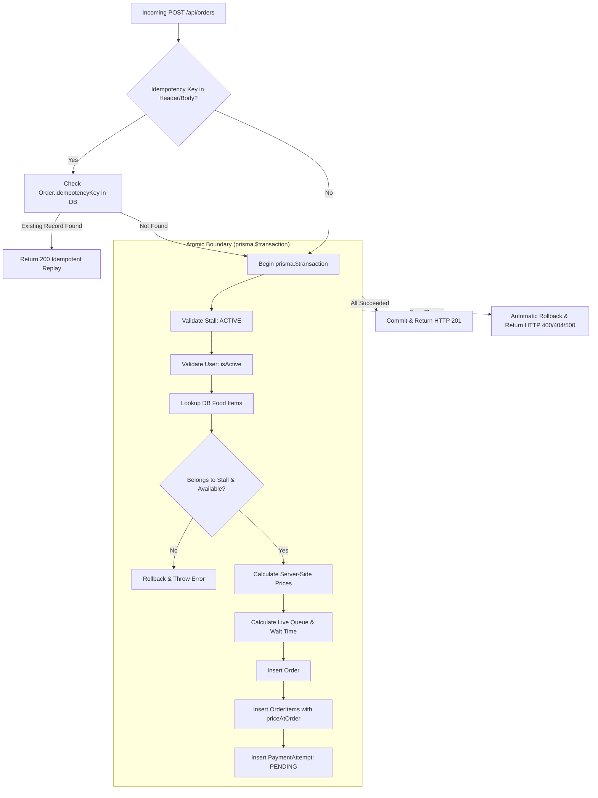

# Campus Bites — Order Processing Reliability & State Machine Architecture

## 1. Executive Summary

In a high-throughput campus food ordering platform, order processing reliability is paramount. Campus Bites implements a resilient, idempotent, and transactional order lifecycle that protects against network drops, double-submissions, pricing tampering, and race conditions.

All orders are processed through an authoritative server-side pipeline where:
- Orders and order items are created inside an **atomic database transaction** (`prisma.$transaction`).
- Duplicate requests are caught and safely resolved via **idempotency keys** backed by a database unique index.
- Prices, dynamic clearance discounts, and totals are computed strictly from verified database records and recorded immutably in `OrderItem.priceAtOrder`.
- State transitions strictly follow a deterministic state machine with forbidden jumps rejected with HTTP 400.

---

## 2. Order Fulfillment State Machine

The fulfillment lifecycle represents the physical preparation and collection flow of an order. It is strictly separated from payment status to maintain clear separation of concerns.

### 2.1 State Transition Diagram



### 2.2 Transition Rules & Matrix

| From State | Allowed Target State(s) | Trigger / Actor | Notes & Enforcement |
|---|---|---|---|
| `PAYMENT_PENDING` | `PLACED`, `CANCELLED` | Customer Payment, Webhook, Customer Cancellation | Initial state upon creation. Awaiting payment capture. |
| `PLACED` | `PREPARING`, `CANCELLED` | Stall Staff, Customer | Order is accepted and queued. Customer cancellation is permitted. |
| `PREPARING` | `READY` | Stall Staff | Cooking commenced. **Cancellation strictly disallowed** (ingredients used). |
| `READY` | `COMPLETED` | Stall Staff | Food is packaged at counter awaiting pickup token presentation. |
| `COMPLETED` | *None (Terminal)* | — | Final state. Rejects all transitions with HTTP 400. |
| `CANCELLED` | *None (Terminal)* | — | Final state. Rejects all transitions with HTTP 400. |

### 2.3 Illegal Transition Guard

Any attempt to execute an invalid transition results in an immediate **HTTP 400 Bad Request** error:

```json
{
  "error": "Invalid transition: PLACED → COMPLETED. Allowed: PREPARING, CANCELLED"
}
```

Disallowed transitions include:
- `PLACED -> COMPLETED` (skipping kitchen preparation and ready stage)
- `PREPARING -> CANCELLED` (attempting cancellation after food preparation has begun)
- `READY -> CANCELLED` (attempting cancellation after food is packaged)
- `COMPLETED -> CANCELLED` (attempting cancellation of already fulfilled orders)

---

## 3. Transaction Boundaries & Atomicity

To prevent partial order creation or orphaned items if a failure occurs mid-request, all order writes are executed within an atomic `prisma.$transaction`:



### 3.1 Failure Rollback Guarantee
If an order payload specifies 5 valid items and 1 invalid item (e.g. non-existent ID or sold-out item), the entire batch rolls back. Zero rows remain in `Order` or `OrderItem`.

---

## 4. Idempotency Architecture

Network timeouts and rapid double-clicks by users on mobile/web clients can result in duplicate order submissions and double charges. Campus Bites provides end-to-end idempotency protection.

### 4.1 Key Ingestion & Extraction
Clients supply a unique idempotency key using standard headers or body payload:
- `Idempotency-Key: <UUID>`
- `x-idempotency-key: <UUID>`
- Body: `{ "idempotencyKey": "<UUID>" }`

### 4.2 Database Unique Constraint
The `Order` model in Prisma schema includes:
```prisma
model Order {
  id             Int     @id @default(autoincrement())
  idempotencyKey String? @unique
  ...
}
```

### 4.3 Race Condition & Duplicate Resolution
1. **Pre-check**: The controller first queries `prisma.order.findUnique({ where: { idempotencyKey } })`. If found, it immediately returns the existing order.
2. **Concurrent Race Protection**: If two identical requests arrive simultaneously and pass the pre-check, the PostgreSQL unique index will reject the second insert with error `P2002` (`Unique constraint failed on the fields: (idempotencyKey)`).
3. **Graceful Capture**: The controller catches `P2002`, loads the concurrently created order, and returns it with HTTP 200 and `isDuplicate: true`.

```json
{
  "message": "Order already placed (idempotent replay)",
  "orderId": 142,
  "id": 142,
  "totalAmount": 170,
  "pickup_token": "TK-1142",
  "queue_number": 3,
  "isDuplicate": true,
  "isSimulated": true
}
```

---

## 5. Authoritative Server-Side Pricing

Client-supplied item prices, discounts, and totals are strictly ignored to prevent client-side price tampering.

### 5.1 Calculation Pipeline
For each item in the order request:
1. Lookup authoritative record from `FoodItem` table.
2. Verify item belongs to target `shopId` (`food.shopId === shop.id`).
3. Verify item is in stock (`food.isAvailable === true`).
4. Calculate authoritative unit price:
   - **Dynamic Clearance Pricing**: If `food.isDynamicPricing && food.discountPercent > 0`:
     $$\text{unitPrice} = \max\left(5, \text{round}\left((\text{food.originalPrice} \parallel \text{food.price}) \times \left(1 - \frac{\text{discountPercent}}{100}\right)\right)\right)$$
   - **Stall Closing Clearance**: Else if `shop.isClosingSoon && shop.closingDiscount > 0`:
     $$\text{unitPrice} = \max\left(5, \text{round}\left(\text{food.price} \times \left(1 - \frac{\text{shop.closingDiscount}}{100}\right)\right)\right)$$
   - **Regular Menu Price**: Else `unitPrice = food.price`.
5. Accumulate total: $\text{calculatedTotal} += \text{unitPrice} \times \text{quantity}$.
6. Store `priceAtOrder: unitPrice` in `OrderItem` record. This guarantees that future price changes on the menu never alter historical order records.

---

## 6. Live Queue & Delivery Time Estimation

To set accurate student expectations, queue positioning and ready times are dynamically derived:
- **Active Orders Count**: Orders currently in `PLACED` or `PREPARING` status for the target stall.
- **Queue Number**: $\text{queueNumber} = \text{activeOrdersCount} + 1$.
- **Preparation Time**: Item-specific prep time based on culinary category (e.g., Hot Beverages: 4 min; Maggi/Snacks: 8 min; Burgers/Dosas: 12 min; Combos/Biryani: 15 min).
- **Estimated Ready Time**:
  $$\text{estimatedMinutes} = \text{maxPrepTime} + (\text{activeOrdersCount} \times 3)$$
  $$\text{estimatedReadyTime} = \text{orderTime} + (\text{estimatedMinutes} \times 60 \times 1000)$$

---

## 7. Customer Cancellation & Staff Status Control

### 7.1 Customer Self-Service Cancellation
- Endpoint: `PATCH /api/orders/:orderId/cancel`
- Authorization: Customer who placed the order or system `ADMIN`.
- State Guard: Order must be in `PAYMENT_PENDING` or `PLACED`.
- Action: Order transitions to `CANCELLED`. Associated `PENDING` payment attempt is marked `CANCELLED`; if payment was already `SUCCESS`, payment attempt is marked `REFUNDED`.

### 7.2 Stall Staff Order Management
- Endpoint: `PATCH /api/staff/orders/:orderId/status`
- Authorization: Authenticated staff member assigned specifically to the order's stall (`order.shopId === staff.shopId`).
- Transition Guard: Evaluated against `ALLOWED_ORDER_TRANSITIONS`. Unauthorized transitions return HTTP 400.
