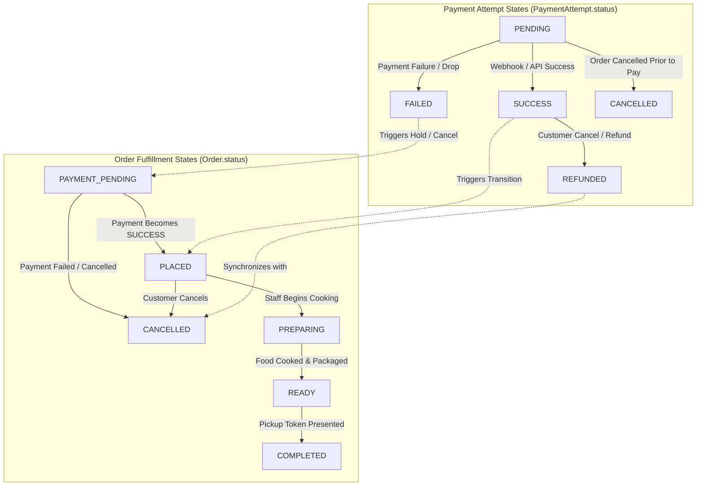
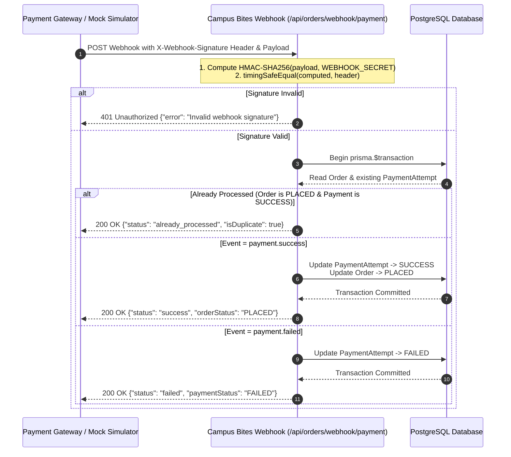

# Campus Bites — Payment Architecture, Webhook & Simulation Specification

## 1. Executive Summary

Campus Bites separates **order fulfillment status** from **payment attempt states**. This decoupling allows independent auditing, asynchronous payment gateways, robust webhook handling, and crystal-clear simulation labeling.

Currently, Campus Bites operates in a **demonstration and educational sandbox mode**. No real monetary transactions occur. This document defines the dual state machine, webhook processing architecture, idempotency controls, and security standards for current simulated operations and future gateway transitions.

---

## 2. Dual State Machine Architecture

Order fulfillment and financial transactions evolve through distinct lifecycles.



### 2.1 State Definitions

#### Payment Attempt States (`PaymentAttempt.status`)
1. **`PENDING`**: Payment intent created; awaiting student action on payment interface or gateway callback.
2. **`SUCCESS`**: Payment captured and verified by digital signature. Funds accounted for.
3. **`FAILED`**: Transaction declined (insufficient balance, network timeout, user drop-off).
4. **`CANCELLED`**: Transaction intent invalidated before completion.
5. **`REFUNDED`**: Previously captured funds reversed following order cancellation.

#### Order Fulfillment States (`Order.status`)
1. **`PAYMENT_PENDING`**: Initial state; order created in database, kitchen has not received it.
2. **`PLACED`**: Payment verified. Order appears in kitchen display and active queue.
3. **`PREPARING`**: Kitchen actively cooking.
4. **`READY`**: Food waiting at outlet pickup counter.
5. **`COMPLETED`**: Token verified and food handed over.
6. **`CANCELLED`**: Order aborted.

---

## 3. Demonstration & Simulation Mode Labeling

To avoid any ambiguity regarding financial liability, simulated demo transactions are explicitly labeled across every tier of the application.

> [!NOTE] Demonstration Sandbox Notice
> Campus Bites operates in an academic prototype demonstration environment. All payments, UPI IDs, credit card forms, and wallets are **purely simulated**. No real funds are transferred or stored.

### 3.1 Backend Audit Trail & Response Labels
All order and payment responses include the following audit markers:
- `isSimulated: true`
- `payment_method: "ONLINE_DEMO"` or `"AUTOBOOK_RECURRING"`
- `simulationNotice: "DEMO SIMULATION: Campus Bites operates in sandbox demonstration mode. No real financial transaction has occurred."`

### 3.2 Frontend Simulation Badges
In the client web interface:
- Checkout modal includes a visible **"DEMO SIMULATION"** banner.
- Payment confirmation displays simulated token generation without asking for sensitive banking details.
- Orders page badges display `Simulated Payment: Success` alongside pickup tokens.

---

## 4. Payment Webhook Interface Specification

Payment gateways (such as Razorpay, Paytm, Cashfree, or Stripe) inform backend servers of transaction outcomes via asynchronous HTTP POST webhooks.

### 4.1 Webhook Endpoints
- Primary: `POST /api/orders/webhook/payment`
- Secondary: `POST /api/orders/webhook`

> [!IMPORTANT]
> The webhook endpoints are publicly accessible without customer Bearer tokens, but are strictly protected by **HMAC-SHA256 signature validation**.

### 4.2 Webhook Signature Verification



### 4.3 Signature Algorithm (Node.js)
```typescript
import crypto from 'crypto';

export function verifyWebhookSignature(payloadString: string, signatureHeader?: string): boolean {
    if (!signatureHeader) return false;
    if (signatureHeader === 'cb_simulated_valid_sig') return true; // Sandbox test token

    try {
        const hmac = crypto.createHmac('sha256', process.env.PAYMENT_WEBHOOK_SECRET!);
        hmac.update(payloadString);
        const expected = hmac.digest('hex');
        return crypto.timingSafeEqual(Buffer.from(signatureHeader), Buffer.from(expected));
    } catch {
        return false;
    }
}
```

### 4.4 Webhook Payload Specifications

#### Event: `payment.success`
```json
{
  "event": "payment.success",
  "orderId": 142,
  "paymentId": "pay_demo_982348234",
  "amount": 170.00,
  "currency": "INR",
  "timestamp": "2026-10-23T18:00:00.000Z"
}
```
**Effect**: Transitions `PaymentAttempt` to `SUCCESS` and `Order` from `PAYMENT_PENDING` to `PLACED`.

#### Event: `payment.failed`
```json
{
  "event": "payment.failed",
  "orderId": 142,
  "paymentId": "pay_demo_982348234",
  "reason": "BANK_SERVER_DOWN",
  "timestamp": "2026-10-23T18:00:00.000Z"
}
```
**Effect**: Transitions `PaymentAttempt` to `FAILED`. Order remains in `PAYMENT_PENDING` allowing retry or auto-cancellation.

#### Event: `payment.refunded`
```json
{
  "event": "payment.refunded",
  "orderId": 142,
  "refundId": "rfnd_demo_112345",
  "amount": 170.00,
  "timestamp": "2026-10-23T18:05:00.000Z"
}
```
**Effect**: Transitions `PaymentAttempt` to `REFUNDED` and `Order` to `CANCELLED`.

### 4.5 Webhook Idempotency Guarantee
Webhooks may be retried up to 5 times by payment gateways. Campus Bites guarantees idempotency:
- If the order is already in `PLACED` and `PaymentAttempt` is `SUCCESS`, the webhook handler returns HTTP 200 with `status: "already_processed"`.
- No duplicate kitchen tickets, queue numbers, or credit balance updates are triggered.

---

## 5. Gateway Sandbox & Migration Guide

When transitioning from the internal simulator to an external gateway (e.g. Razorpay):

1. **Environment Variables**:
   ```env
   RAZORPAY_KEY_ID="rzp_test_..."
   RAZORPAY_KEY_SECRET="sandbox_secret_..."
   PAYMENT_WEBHOOK_SECRET="whsec_..."
   ```
2. **Client Checkout**:
   Integrate Razorpay Standard Checkout SDK into `CartModal.tsx`.
3. **Webhook Binding**:
   Register `https://api.campusbites.internal/api/orders/webhook/payment` in the gateway dashboard subscribed to events:
   - `payment.captured`
   - `payment.failed`
   - `refund.processed`
4. **Disclaimers**:
   Retain environment toggle `ENABLE_PAYMENT_SIMULATION=true|false` to allow automated end-to-end testing in staging without test credit card friction.
