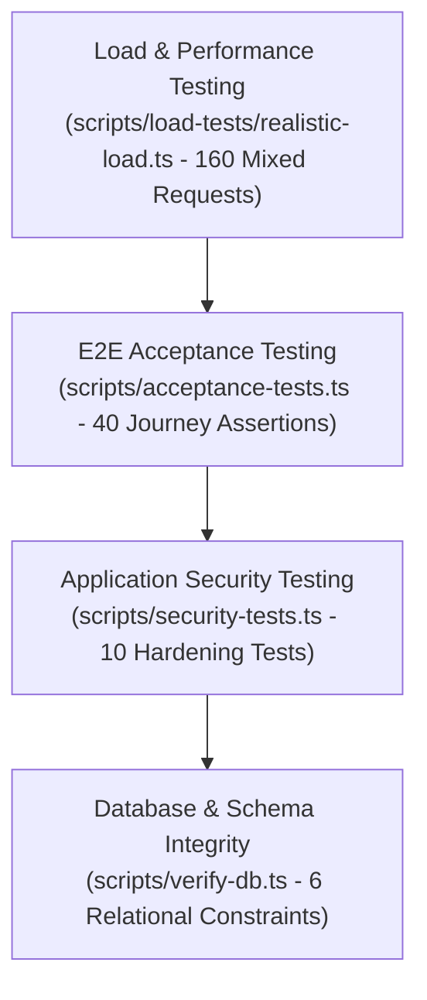

# Campus Bites - Comprehensive Testing Strategy & Guide

This document defines the complete testing pyramid, test suite catalog, execution commands, and quality assurance standards for the Campus Bites platform.

---

## 1. Testing Pyramid & QA Philosophy

Campus Bites employs a multi-layered testing strategy ensuring data integrity, authorization security, operational state flow, and performance under peak campus concurrency:



### Core Principles
1. **Live Cloud Database Testing**: Tests run against real PostgreSQL instances rather than mocked in-memory databases, ensuring that actual constraints (uniqueness, foreign keys, cascades, indexes) are actively verified.
2. **Zero Hardcoded Mocking**: All user journeys test real HTTP request/response pipelines using Supertest, verifying body parsing, headers, Zod schemas, and status codes.
3. **Automated Teardown**: Every test suite cleans up all entities it creates, leaving the database in a pristine state.

---

## 2. Test Suites Catalog

| Test Suite | Script Path | npm Command | Focus Areas | Assertion Count |
| :--- | :--- | :--- | :--- | :---: |
| **Database Architecture** | `backend/scripts/verify-db.ts` | `npm run test:db` | Uniqueness constraints, FK references, cascade deletes, Autobook relationships. | 6 Tests |
| **Security & Hardening** | `backend/scripts/security-tests.ts` | `npm run test:security` | JWT auth, role RBAC, cross-tenant isolation, price tampering, rate limits. | 10 Tests |
| **End-to-End Acceptance** | `backend/scripts/acceptance-tests.ts` | `npm run test:acceptance` | Complete user journeys (Customer, Staff, Owner, Admin, Autobook, Edge Cases). | 40 Tests |
| **Realistic Load Test** | `backend/scripts/load-tests/realistic-load.ts` | `npm run test:load` | Concurrency simulation, p50/p95 latency, throughput (RPS), error rates. | 160 Requests |

---

## 3. How to Execute Tests

All commands are run from the `backend/` directory:

### Run Complete CI Test Suite
```bash
npm test
```
*Executes `test:db`, `test:security`, and `test:acceptance` sequentially.*

### Run Database Integrity Tests
```bash
npm run test:db
```

### Run Application Security Tests
```bash
npm run test:security
```

### Run Comprehensive Acceptance Tests
```bash
npm run test:acceptance
```

### Run Peak Load Benchmark
```bash
npm run test:load
```

---

## 4. Test Directory Structure

```text
backend/
├── scripts/
│   ├── verify-db.ts                 # Database constraint & relational integrity
│   ├── security-tests.ts            # OWASP Top 10 & application security tests
│   ├── acceptance-tests.ts          # Comprehensive multi-role acceptance journeys
│   ├── repair-autobook.ts           # Schema repair and fixture alignment utility
│   └── load-tests/
│       └── realistic-load.ts        # Concurrent virtual user traffic generator
├── src/
│   ├── middleware/
│   │   ├── auth.ts                  # Token authentication & RBAC middleware
│   │   └── rateLimiters.ts          # Rate limiters with test bypass support
│   ├── validators/                  # Zod request validation schemas
│   └── app.ts                       # Express application entrypoint
```

---

## 5. Quality Standards & CI Thresholds

1. **Zero Failing Tests**: No PR may merge with any failing test in `test:db`, `test:security`, or `test:acceptance`.
2. **Error Rate < 1% Under Load**: Benchmark runs must demonstrate `< 1.00%` failure rate at target concurrency.
3. **Idempotency Guarantee**: Running the test suites repeatedly against the same database must succeed without constraint violations or accumulating dirty records.
