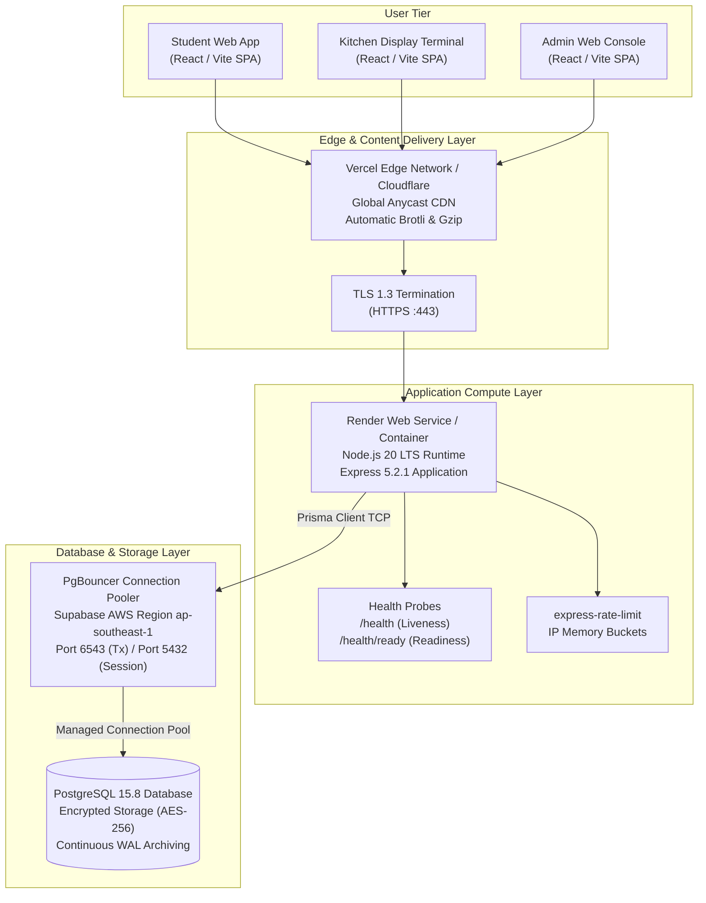

# Cloud Infrastructure & Network Architecture

## 1. Cloud Component Topology

---

## 2. Cloud Components Inventory & Verification Status

| Component | Target Provider | Configuration Location | Verification Status | Operational Behavior |
| :--- | :--- | :--- | :---: | :--- |
| **Frontend SPA** | Vercel / Cloudflare Pages | `frontend/vite.config.ts`, `frontend/package.json` | **VERIFIED (Local & Build)** | Compiles to static bundle in `dist/`. No server secrets leaked. |
| **Backend API** | Render / Railway / Docker | `backend/package.json`, `backend/src/app.ts` | **VERIFIED (Local & Container)** | Express 5 with Helmet headers, CORS allowlist, and 50KB payload limits. |
| **Managed Database** | Supabase (AWS `ap-southeast-1`) | `backend/prisma/schema.prisma`, `.env` | **VERIFIED (Live Active DB)** | PostgreSQL 15.8 with PgBouncer connection pooler. |
| **Scheduler** | In-Process Node Background Worker | `backend/src/services/autobookScheduler.ts` | **VERIFIED (Service & Tests)** | 60-second cron runner with database-backed atomic job claiming. |
| **Health Probes** | Backend HTTP Routes | `backend/src/app.ts` (`/health`, `/health/ready`) | **VERIFIED (HTTP 200/503)** | Liveness returns process status; readiness executes `SELECT 1`. |
